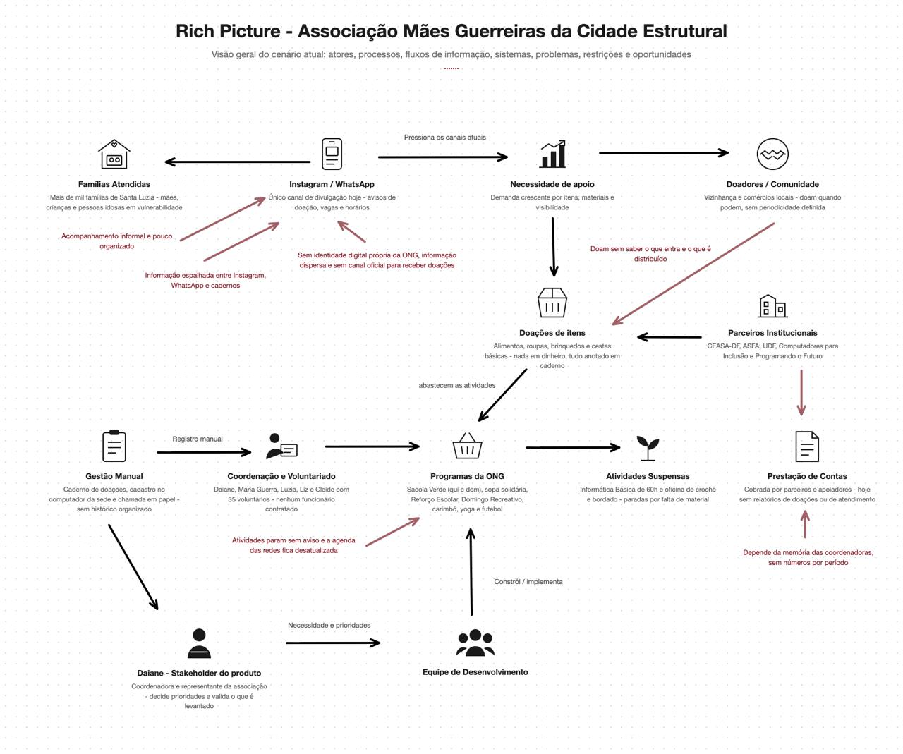

# Visão do Produto

Esta página reúne, em seções, tudo o que descreve o produto e o projeto: o cliente e o problema,
a solução, a intervenção social, o processo, a Engenharia de Requisitos, o cronograma e a equipe.
Os requisitos ficam no [catálogo integrado](../08-requisitos/index.md).

[1 · Cenário](#1-cenario-atual-do-cliente-e-do-negocio) ·
[2 · Solução](#2-solucao-proposta) ·
[3 · Intervenção social](#3-intervencao-social) ·
[4 · Estratégias](#4-estrategias-de-engenharia-de-software) ·
[5 · Engenharia de Requisitos](#5-engenharia-de-requisitos) ·
[6 · Cronograma](#6-cronograma-e-entregas) ·
[7 · Equipe](#7-interacao-entre-equipe-e-cliente)

## 1. Cenário Atual do Cliente e do Negócio

### 1.1 Identificação do Cliente/Parceiro

- **Nome:** Associação Mães Guerreiras da Cidade Estrutural 
- **Tipo:** Associação comunitária sem fins lucrativos, mantida integralmente por trabalho voluntário.
- **Representante:** Daiane, coordenadora da associação.
- **Contato principal da equipe:** Makio Augusto Cândido, voluntário.
- **Outros contatos:** Maria Guerra (presidente) e as coordenadoras Luzia, Liz e Cleide. O papel de
  cada pessoa no projeto está no [mapa de stakeholders](#16-mapa-de-stakeholders).
- **Forma de contato:** Telefone, WhatsApp e Instagram institucional
  (@maesguerreiras_df).
- **Vínculo com o projeto:** cliente real e parte interessada principal.

### 1.2 Introdução ao Negócio e Contexto

A Associação Mães Guerreiras da Cidade Estrutural nasceu em 2019 da mobilização de mães em situação de vulnerabilidade da comunidade de Santa Luzia, na Cidade Estrutural (DF), região marcada pela ausência de saneamento básico, água potável e infraestrutura urbana. A associação é mantida por cerca de 35 voluntárias e voluntários (não há funcionários contratados) e é conduzida por uma presidente,
Maria Guerra, e por um grupo de coordenadoras responsáveis pelas diferentes frentes de atuação.
A associação atua praticamente de domingo a domingo, com ações organizadas em quatro eixos:
educação e capacitação, segurança alimentar, convivência e bem-estar, e geração de renda. Na doação
de alimentos, já foram atendidas mais de mil famílias da comunidade.

#### Educação e capacitação

- **Reforço Escolar:** Às terças e sextas-feiras, das 8h30 às 10h30 e das 14h30 às 16h30, em Português e
  Matemática, para alunos do Ensino Fundamental e Médio.
- **Informática Básica:** Curso gratuito de 60 horas com emissão de certificado, realizado no laboratório de informática mantido em parceria com os programas Computadores para Inclusão e Programando o Futuro (Ministério das Comunicações). Está temporariamente suspenso, aguardando a organização do segundo andar da sede.

#### Segurança alimentar

- **Sacola Verde (entrega de verduras):** Às quintas-feiras e aos domingos, das 14h30 às 15h30, com apoio da CEASA-DF. O atendimento é organizado por ordem de chegada, com entrega de senhas.
- **Doação de sopa e cozinha solidária:** Às quartas-feiras, com apoio da ASFA, voltada a pessoas em situação de vulnerabilidade.
- **Doação de mantimentos e cestas básicas:** Cestas básicas, frangos, peixes e pães, distribuídos ocasionalmente e avisados no grupo de WhatsApp. Como não há doadores fixos, não existe data definida para as distribuições.

#### Convivência, cultura e bem-estar

- **Domingo Recreativo:** Realizado em dois domingos por mês, reúne em média 80 crianças, com futebol, pintura, café da manhã e almoço. Para alcançar mais crianças, a associação faz um rodízio mensal entre os grupos. Sua realização depende do recebimento de doações.
- **Futebol:** Aos domingos pela manhã, voltado ao desenvolvimento físico e ao trabalho em equipe. É a única atividade que não é divulgada nas redes sociais.
- **Carimbó:** Grupo de voluntárias que ensaia uma vez por semana e se apresenta quando a associação é convidada e dispõe de recursos para participar.
- **Yoga e Hitbox:** Yoga às segundas-feiras e hitbox às quartas-feiras, das 9h às 10h, voltados à saúde e ao bem-estar das mulheres da comunidade.
- **Roda de Conversa com psicólogo:** Aos sábados, das 15h às 16h, conduzida por estudantes de Psicologia da UDF, com foco em escuta e acolhimento das mães.
- **Oficinas com mulheres e atividades com idosos:** Encontros de aprendizado, convivência e valorização das pessoas idosas da comunidade.

#### Geração de renda

- **Crochê e bordado:** Oficina voltada à autoestima e à geração de renda extra das mães. Está temporariamente suspensa, aguardando equipamentos ou recursos para a compra de materiais.

#### Como a associação se organiza hoje

Toda a gestão é feita de forma manual: cadernos de doações, cadastro das famílias em um computador da sede (nome, idade, endereço e telefone) e chamada em papel. Os problemas que isso gera estão na seção [1.4](#14-identificacao-da-oportunidade-ou-problema).

A comunicação interna acontece por reuniões presenciais e grupos de WhatsApp, e a divulgação para a comunidade é feita pelo Instagram (@maesguerreiras_df), pelo Facebook, por panfletos e por cartões de divulgação. A associação conta ainda com parceiros institucionais como CEASA-DF, ASFA, UDF e os programas federais Computadores para Inclusão e Programando o Futuro.

### 1.3 Rich Picture

### 1.4 Identificação da Oportunidade ou Problema

A associação tem uma operação consolidada, parceiros institucionais reconhecidos e alcance real na
comunidade, mas toda a sua gestão depende de registros manuais que se perdem. Isso gera problemas
concretos:

- As doações de itens (alimentos, roupas, brinquedos e cestas básicas) são anotadas em cadernos e,
  por falta de tempo, nem sempre são registradas: parte do que entra e do que é distribuído
  simplesmente não fica documentado;
- Não existe nenhum relatório organizado: a associação não sabe dizer com precisão quanto recebeu
  por mês, por campanha, quantas doações chegaram nem quais tipos de itens foram distribuídos;
- Sem esses números, a prestação de contas a parceiros como CEASA-DF, ASFA e UDF depende da
  memória das coordenadoras, e a associação perde argumentos concretos para conquistar novos
  apoiadores e patrocinadores;
- O cadastro das famílias existe em um computador da sede, mas não se conecta ao controle de
  presença nem ao registro das doações distribuídas;
- A chamada das crianças no Reforço Escolar, no futebol e no Domingo Recreativo é feita em papel, e
  a regra de liberar a vaga após 3 faltas sem justificativa depende de conferência manual;
- O atendimento da Sacola Verde é organizado por ordem de chegada com entrega de senhas, sem
  registro de quem foi atendido em cada distribuição;
- A comunidade não tem onde consultar o que está ativo: atividades suspensas (Informática Básica e
  Crochê e Bordado) e atividades que dependem de doação (Domingo Recreativo) se misturam às
  demais nas redes sociais;
- Informações institucionais dependem de Stories e destaques do Instagram, de panfletos e de
  cartões, e as vagas em novas turmas são divulgadas apenas nos grupos de WhatsApp, alcançando
  quem já está próximo da associação.

### 1.5 Desafios do Projeto

Os riscos que decorrem destes desafios, e como são tratados, estão em [2.6](#26-viabilidade-da-proposta).

- A coordenação tem baixa familiaridade com ferramentas digitais além do WhatsApp e das redes
  sociais: se o registro de uma doação não for mais rápido que anotar no caderno, a ferramenta não
  será adotada;
- São cinco coordenadoras com responsabilidades diferentes, o que exige controle de acesso por
  perfil em vez de um único login compartilhado;
- O sistema tratará dados pessoais de famílias em situação de vulnerabilidade (nome, idade,
  endereço e telefone), o que exige cuidado com privacidade e conformidade com a LGPD;
- O projeto é conduzido em regime pro bono, sem orçamento, o que restringe hospedagem, domínio
  e demais serviços às alternativas gratuitas;
- A associação tem muitas frentes e um calendário semanal cheio, e a disponibilidade das voluntárias
  para validar entregas é limitada: as validações precisam ser curtas;
- O escopo levantado é ambicioso para um semestre, sendo necessário priorizar rigorosamente o que
  entra no MVP.

### 1.6 Mapa de Stakeholders

Para diferenciar o poder de decisão de cada stakeholder dos efeitos que a implantação produzirá sobre ele, o mapa considera três dimensões: poder de decisão, impacto sofrido pela implantação e participação esperada na Engenharia de Requisitos.

| Stakeholder | Relação com a solução | Interesse principal | Poder de decisão | Impacto sofrido | Participação esperada na Engenharia de Requisitos |
| --- | --- | --- | --- | --- | --- |
| Daiane (coordenação) | Representante do cliente | Garantir que a solução represente a associação e apoie a captação de parcerias | Alto | Alto | Apresentará as necessidades da associação e esclarecerá as regras do negócio |
| Makio Augusto Cândido | Voluntário principal que faz a ponte de comunicação entre a equipe e a associação | Validar o escopo, as prioridades e as entregas do projeto | Alto | Médio | Validará o escopo, as prioridades e as entregas do projeto |
| Demais coordenadoras (Luzia, Liz e Cleide) | Usuárias diretas do painel administrativo | Registrar doações, cadastros e presença de forma rápida, com acesso conforme suas responsabilidades | Médio | Alto | Explicarão os processos atuais, esclarecerão regras operacionais e avaliarão as funcionalidades relacionadas às suas atividades |
| Voluntárias e voluntários | Usuários diretos do painel administrativo e apoiadores das atividades | Saber onde ajudar e registrar as atividades que conduzem | Baixo | Médio | Não participarão das atividades de Engenharia de Requisitos; suas necessidades serão apresentadas pelas coordenadoras |
| Famílias beneficiárias | Pessoas impactadas pela solução e usuárias do portal público | Saber o que está ativo, como participar e ser atendidas com organização | Baixo | Alto | Não participarão das atividades de Engenharia de Requisitos; suas necessidades serão representadas pela coordenação |
| Doadores de itens — pessoas e comércios | Usuários do portal público | Doar de forma simples e consultar as necessidades da associação | Baixo | Médio | Não participarão das atividades de Engenharia de Requisitos; suas necessidades relacionadas ao portal serão apresentadas pela coordenação |
| Parceiros institucionais — CEASA-DF, ASFA, UDF, Computadores para Inclusão e Programando o Futuro | Apoiadores institucionais e consumidores de relatórios | Acompanhar o impacto do apoio concedido | Baixo | Médio | Não participarão das atividades de Engenharia de Requisitos; suas necessidades de relatórios e prestação de contas serão apresentadas pela coordenação |
| Equipe de desenvolvimento | Responsável pela construção do produto | Entregar uma solução viável, simples de usar e de qualidade | Médio, restrito às decisões técnicas | Alto | Elicitará, analisará, documentará, verificará e atualizará os requisitos, além de implementar a solução |

### 1.7 Segmentação de "Clientes" (usuários da plataforma)

Os públicos foram segmentados conforme a forma como utilizarão, validarão ou serão impactados pela plataforma. Um mesmo stakeholder pode pertencer a mais de um segmento quando possuir diferentes relações com a solução.

| Segmento | Integrantes | Relação com a solução |
| --- | --- | --- |
| Usuários diretos do painel administrativo | Daiane, as demais coordenadoras e voluntárias e voluntários autorizados | As coordenadoras registrarão doações, cadastros e presença, com acessos compatíveis com suas responsabilidades. Os voluntários consultarão onde e quando poderão ajudar e registrarão as atividades que conduzirem |
| Usuários do portal público | Famílias beneficiárias, doadores de itens, pessoas da comunidade, comércios e potenciais apoiadores | As famílias consultarão as atividades disponíveis e as formas de participação. Os doadores consultarão as necessidades da associação e as informações para entrega de alimentos, roupas, brinquedos e mantimentos |
| Pessoas apenas impactadas | Mães, crianças, pessoas idosas e demais moradores de Santa Luzia que participam das atividades ou recebem doações, mas não utilizarão diretamente a plataforma | Serão beneficiados pela melhoria na organização dos cadastros, das inscrições, da presença, das doações e dos atendimentos |
| Parceiros que consomem relatórios | CEASA-DF, ASFA, UDF, Computadores para Inclusão, Programando o Futuro e potenciais patrocinadores | Receberão informações e relatórios sobre as atividades realizadas, as doações registradas e o impacto do apoio concedido |

Quem valida o produto está no [mapa de stakeholders](#16-mapa-de-stakeholders). As personas usadas para organizar os requisitos estão no [mapa de histórias](../12-mapa/index.md).

## 2. Solução Proposta

### 2.1 Objetivo Geral do Produto

O objetivo do produto é substituir os controles manuais da Associação Mães Guerreiras (cadernos de
doações, cadastro isolado no computador da sede e listas de chamada em papel) por uma plataforma
web simples, que registre as doações de itens recebidas e distribuídas, o cadastro das
famílias e a presença nas atividades, e que transforme esses registros em relatórios de impacto capazes
de sustentar a prestação de contas aos parceiros. A plataforma oferece ainda um canal institucional
próprio, onde a comunidade encontra a agenda atualizada das atividades, sua situação atual e as formas
de apoiar a associação.

### 2.2 Objetivos Específicos (OE) do Produto

- **OE1:** Apresentar de forma permanente e acessível as atividades da associação, com dias, horários e
  situação atual, além das formas de doar e de fazer parte;
- **OE2:** Substituir o registro em caderno pelo registro digital das doações de itens recebidas
  e distribuídas;
- **OE3:** Centralizar o cadastro das famílias e as inscrições nas atividades, permitindo que uma mesma
  família participe de várias frentes;
- **OE4:** Digitalizar a chamada das atividades e apoiar a regra de frequência já praticada pela
  coordenação;
- **OE5:** Gerar relatórios de impacto para prestação de contas aos parceiros e captação de novos
  apoiadores;
- **OE6:** Organizar o acesso ao painel administrativo por perfil, protegendo os dados pessoais das
  famílias atendidas.

### 2.3 Características de Produto

A solução proposta para a Associação Mães Guerreiras deverá contemplar, de forma preliminar, as
seguintes características, mapeadas com os Objetivos Específicos do Produto:

| ID | Característica de Produto (CP) | Descrição resumida | VN | Valor de negócio (VN) principal |
| :--- | :--- | :--- | :--- | :--- |
| CP1 | Portal institucional e agenda de atividades | Disponibilização das informações institucionais e das atividades da associação. | VN1 | Centralização das informações destinadas à comunidade e aos apoiadores. |
| CP2 | Registro de doações de itens | Gestão das doações de itens recebidas e distribuídas. | VN2 | Redução de registros de doações não realizados e maior visibilidade sobre os itens recebidos e distribuídos. |
| CP3 | Cadastro de famílias e participantes | Gestão dos dados das famílias e participantes atendidos. | VN3 | Centralização dos dados atualmente mantidos de forma isolada. |
| CP4 | Inscrição em atividades e organização do atendimento | Gestão das inscrições e dos atendimentos nas atividades. | VN4 | Organização e rastreabilidade dos atendimentos realizados. |
| CP5 | Chamada digital e controle de frequência | Gestão da frequência dos participantes nas atividades. | VN5 | Redução da conferência manual de presença e apoio à aplicação da regra de faltas. |
| CP6 | Relatórios e indicadores de impacto | Acompanhamento dos resultados e indicadores da associação. | VN6 | Apoio à prestação de contas e à captação de novos apoiadores. |
| CP7 | Perfis de acesso e proteção de dados | Controle de acesso e proteção dos dados tratados pela solução. | VN7 | Proteção dos dados das famílias atendidas e conformidade com a LGPD. |

O quadro a seguir apresenta a contribuição de cada característica para os Objetivos Específicos (OE1 a
OE6) definidos na seção anterior.

| ID | Característica de Produto (CP) | Contribuição principal (OE) | Contribuição secundária (OE) |
| :--- | :--- | :--- | :--- |
| CP1 | Portal institucional e agenda de atividades | OE1 | OE5 |
| CP2 | Registro de doações de itens | OE2 | OE5 |
| CP3 | Cadastro de famílias e participantes | OE3 | OE6 |
| CP4 | Inscrição em atividades e organização do atendimento | OE3 | — |
| CP5 | Chamada digital e controle de frequência | OE4 | OE5 |
| CP6 | Relatórios e indicadores de impacto | OE5 | — |
| CP7 | Perfis de acesso e proteção de dados | OE6 | — |

### 2.4 Tecnologias a Serem Utilizadas

A tabela a seguir apresenta a stack tecnológica definida para a construção da plataforma.

| Camada | Tecnologia | Função |
| :--- | :--- | :--- |
| Frontend + parte do backend | **Nuxt.js** | Interface pública, painel administrativo, server routes (Nitro) para API |
| Banco de dados + autenticação | **Supabase** | PostgreSQL, login da coordenação, storage de imagens |
| Hospedagem | **Vercel** ou **Netlify** | Deploy automático via GitHub, subdomínio grátis |

**Doações:** o sistema tratará apenas doações de itens.

**Controle de versão e documentação:** Git e GitHub, com o site do projeto publicado via GitHub Pages,
conforme exigido pela disciplina.

### 2.5 Pesquisa de Mercado e Análise Competitiva

#### Ferramentas utilizadas atualmente pela associação

A associação não utiliza hoje nenhum sistema de gestão.

| Alternativa | O que resolve hoje | Limitações para a associação |
| :--- | :--- | :--- |
| Instagram e Facebook | Divulgação das ações, alcance da comunidade e captação de novos apoiadores. | Não centralizam os registros de doações, inscrições e frequência; informações sobre atividades ficam dispersas entre publicações. |
| Cadernos, papel e cadastro isolado no computador | Registro das doações, do cadastro das famílias e da chamada das crianças. | Parte das doações não é registrada; os dados não se conectam; a consulta depende da disponibilidade dos registros e a elaboração de relatórios exige consolidação manual. |
| Grupos de WhatsApp | Comunicação interna entre voluntárias e aviso rápido de distribuições e novas turmas. | Informações se dispersam no histórico; não há registro estruturado e integrado de inscrições, presença e doações. |
| Ferramentas genéricas gratuitas (formulários e planilhas online) | Alternativa para coleta de dados e controles simples. | Exigem configuração dos campos, vínculos e permissões de acesso pela equipe; não oferecem prontas as regras específicas da associação. |

Formulários e planilhas são apresentados como alternativa genérica de comparação, sem pressupor sua
adoção atual pela associação.

#### Soluções similares disponíveis no mercado

Foram pesquisadas soluções disponíveis no mercado destinadas à gestão de organizações sociais,
beneficiários e indicadores de impacto, bem como ao controle de doações de itens e ao registro de
frequência em projetos sociais. A comparação utiliza informações públicas dos fornecedores, consultadas
em 18/09/2026; recursos não confirmados nessas fontes não são considerados inexistentes.

| Solução similar | Recursos relacionados à proposta | Limitações em relação ao contexto da associação |
| :--- | :--- | :--- |
| [Bússola Social](https://www.bussolasocial.com.br/) | Gestão de organizações sociais por meio de projetos, beneficiários, indicadores, evidências, inscrições e relatórios de impacto. | O atendimento ao fluxo de doações de itens e às regras específicas de frequência da associação não foi confirmado nas fontes consultadas. |
| [Ongsys](https://site.ongsys.com.br/) | Gestão financeira por projeto, doadores, voluntários, documentos, relatórios e prestação de contas. | Possui maior foco financeiro, contábil e administrativo do que no acompanhamento cotidiano das famílias e atividades oferecidas. |
| [Trackmob](https://trackmob.com.br/) | Gestão de doadores, doações financeiras, relacionamento e captação de recursos. | É orientada principalmente à captação e ao processamento de doações financeiras, enquanto a proposta trata doações de itens. |
| [PantrySoft](https://www.pantrysoft.com/feature/donations-and-inventory/) | Controle de doações de itens, recebimentos e estoque; acompanhamento da distribuição por beneficiário, conforme a [documentação de relatórios](https://support.pantrysoft.com/inventory-reports). | Voltado a bancos de alimentos e atendimento de necessidades básicas. O suporte à chamada e à regra de 3 faltas das atividades da associação não foi confirmado nas fontes consultadas. |
| [TraxSolutions / TraxAttendance — nFocus](https://www.nfocus.com/) | Gestão de participantes e frequência em programas sociais. O [TRAX Attendance Manager](https://play.google.com/store/apps/details?id=com.nfocus.tam) registra presença nas instalações e atividades, inclusive offline, com sincronização posterior. | O suporte integrado a doações de itens e à regra de 3 faltas sem justificativa não foi confirmado nas fontes consultadas. |

A pesquisa contempla as cinco frentes solicitadas: gestão de organizações sociais (Bússola Social e
Ongsys), doações de itens (PantrySoft), beneficiários (Bússola Social e PantrySoft), frequência
(TraxSolutions/TraxAttendance) e indicadores e relatórios de impacto (Bússola Social). Trackmob
complementa a comparação com soluções de captação financeira.

Existem soluções para essas frentes. Entretanto, a consulta às fontes públicas não demonstrou o
atendimento conjunto a todas as necessidades e regras específicas das Mães Guerreiras. A proposta
busca integrar esses processos à rotina da associação; essa adequação deverá ser validada com a
coordenação. Não se conclui, apenas com esta pesquisa, que os produtos analisados sejam incapazes
de atender ao contexto mediante configuração ou adaptação.

### 2.6 Viabilidade da Proposta

A proposta é viável no contexto da disciplina, considerando o prazo disponível, a equipe de 6 integrantes
e o acesso real ao cliente, que mantém contato frequente por WhatsApp. Ainda que parte da equipe
esteja em processo de aprendizado das tecnologias escolhidas, a proposta foi estruturada de forma
compatível com essa realidade: entregas incrementais em sprints de 2 semanas
([4](#4-estrategias-de-engenharia-de-software) e [6](#6-cronograma-e-entregas)), priorização das
funcionalidades essenciais e validações frequentes com a coordenação ([7.3](#73-processo-de-validacao)).

A primeira priorização (28/09/2026) avaliou o valor por característica de produto; a atual foi
feita pela cliente requisito a requisito e define um MVP de 19 RFs. O objetivo, os limites, o critério e a matriz do recorte
estão na seção [10](../10-mvp/index.md); os requisitos selecionados estão marcados no
[catálogo](../08-requisitos/index.md#mvp-sim).

#### Riscos e mitigação

| Risco | Mitigação |
| :--- | :--- |
| **Não adoção:** se o registro digital não for mais rápido do que anotar no caderno, a coordenação volta ao papel ([1.5](#15-desafios-do-projeto)). | Protótipos validados antes de programar e teste com as próprias coordenadoras, sem ajuda da equipe, a cada sprint ([7.3](#73-processo-de-validacao)). O efeito de abandono é acompanhado em [3.2](#32-efeitos-emergentes-e-respostas). |
| **Escopo ambicioso frente ao prazo:** a associação tem muitas frentes. | MVP restrito ([10](../10-mvp/index.md)); demais requisitos priorizados ciclo a ciclo ([9](../09-priorizacao/index.md)). |
| **Dados pessoais de famílias em vulnerabilidade, inclusive durante os testes.** | Autenticação, perfis de acesso e consentimento entram antes do cadastro de famílias (Sprint 6, [6.2](#62-sprints-previsto-realizado)). Só dados sintéticos até o [portão de uso real](#64-portao-de-liberacao-para-uso-real). Fotos e depoimentos só com autorização de uso de imagem registrada. |
| **Disponibilidade da coordenação:** todas atuam voluntariamente e têm agenda cheia. | Validações curtas, na revisão de cada sprint ([7.2](#72-comunicacao)). |
| **Manutenção após o semestre:** a associação não tem equipe técnica. | Entrega do código-fonte, da documentação e de orientações básicas; plano de transição (T02) ([6.5](#65-fechamento-minimo-e-adicional)). |
| **Contas e hospedagem vinculadas a um integrante.** | Transferência das contas (Supabase, deploy, domínio) para um endereço institucional antes da entrega (T04, [6.5](#65-fechamento-minimo-e-adicional)). |
| **Perda de dados por falha ou exclusão.** | Cópia de segurança diária ([RNF05](../08-requisitos/rnf.md#rnf05)) e restauração testada antes de dados reais ([6.4](#64-portao-de-liberacao-para-uso-real)). |
| **Pouca familiaridade das coordenadoras com ferramentas digitais.** | Treinamento e guia de uso em linguagem simples (T03, [RNF02](../08-requisitos/rnf.md#rnf02)). |
| **Limites dos serviços gratuitos:** o crescimento do uso pode gerar custos. | Acompanhamento dos limites e aviso à associação antes de adotar plano pago ([RNF12](../08-requisitos/rnf.md#rnf12)). |

Assim, a proposta é considerada viável, desde que o escopo do MVP permaneça controlado, as
prioridades sejam mantidas ao longo das sprints e a equipe mantenha o tempo de aprendizado das
tecnologias previsto nas primeiras sprints.

### 2.7 Benefícios Esperados

Os benefícios para a associação, as famílias, as voluntárias e os doadores estão descritos como
impactos pretendidos na seção [3.1](#31-impactos-pretendidos).

Como metas iniciais verificáveis, a equipe pretende permitir o registro de uma doação em até dois
minutos durante o teste com as coordenadoras e reduzir em pelo menos 80% a quantidade de doações sem
registro em comparação com a linha de base levantada antes da implantação. Os valores de dois minutos
e 80% são propostas preliminares, pendentes de discussão na próxima reunião da equipe e posterior
validação com a cliente; não representam metas já acordadas.

## 3. Intervenção Social

A solução proposta para a Associação Mães Guerreiras tende a produzir uma intervenção social voltada
ao fortalecimento institucional de uma organização comunitária que já atende mais de mil famílias,
transformando um trabalho hoje invisível nos registros em informação capaz de sustentar parcerias,
organizar o atendimento e ampliar o alcance das atividades.

### 3.1 Impactos pretendidos

- preservar o registro do que a associação recebe e distribui, hoje perdido por falta de tempo das
  voluntárias;
- dar à associação argumentos concretos (número de famílias atendidas, doações recebidas,
  frequência nas atividades) para prestar contas a parceiros como CEASA-DF, ASFA e UDF e conquistar
  novos apoiadores;
- reduzir o trabalho manual da coordenação, liberando tempo de voluntárias para o atendimento
  direto à comunidade, com acesso organizado por perfil entre as coordenadoras;
- tornar visível para a comunidade o que está ativo, em que dias e horários e como participar,
  incluindo atividades hoje pouco divulgadas, como o futebol de domingo;
- dar às voluntárias um canal claro para saber onde ajudar, e aos doadores informação objetiva sobre
  o que a associação precisa e como entregar;
- organizar o atendimento das distribuições, tornando mais justo e transparente o critério de quem é
  atendido;
- apoiar a aplicação consistente da regra de frequência, permitindo que vagas ociosas sejam ocupadas
  por outras crianças da comunidade;
- preservar a identidade e a narrativa da associação em um canal próprio e permanente.

### 3.2 Efeitos emergentes e respostas

A solução pode gerar efeitos não totalmente previstos. Cada efeito identificado tem uma resposta
concreta no projeto, para que não fique só como preocupação registrada:

| Efeito emergente a observar | Resposta no projeto |
| :--- | :--- |
| Dependência de uma plataforma que exige manutenção, em uma organização sem equipe técnica própria | Plano de transição, documentação operacional e responsável institucional pela manutenção (risco *Manutenção*, [2.6](#26-viabilidade-da-proposta)) |
| Abandono do registro digital, que passa a conviver com o caderno e gera informação duplicada e menos confiável | Testes de adoção a cada sprint ([7.3](#73-processo-de-validacao)), migração gradual e definição de qual registro passa a ser o oficial a partir de cada entrega |
| Exclusão de famílias, doadores e voluntárias com menor acesso ou familiaridade com tecnologia | WhatsApp, redes sociais e panfletos mantidos como canais complementares; acessibilidade da interface ([RNF09](../08-requisitos/rnf.md#rnf09), [RNF18](../08-requisitos/rnf.md#rnf18)) |
| Maior exposição de dados pessoais de famílias em situação de vulnerabilidade | Perfis de acesso por responsabilidade (CP7), coleta mínima e RNFs de segurança e LGPD ([RNF07](../08-requisitos/rnf.md#rnf07), [RNF13](../08-requisitos/rnf.md#rnf13), [RNF19](../08-requisitos/rnf.md#rnf19)) |
| Publicação de fotos e depoimentos de crianças e famílias | Publicação só com autorização de uso de imagem registrada ([RF42](../08-requisitos/index.md#rf42), [RNF14](../08-requisitos/rnf.md#rnf14)) |
| Formalização do atendimento (senhas, cadastro, registro de faltas) percebida como controle ou burocracia | Validação das telas e fluxos com famílias e voluntários antes de tornar o registro obrigatório |

Assim, a intervenção social da solução não é apenas "digitalizar os cadernos" da associação. Ela consiste
em alterar a forma como a comunidade acessa informações sobre as atividades, como o atendimento é
organizado, como o trabalho voluntário é registrado e como a associação se relaciona com seus parceiros
institucionais, exigindo que os requisitos considerem tanto os benefícios esperados quanto os efeitos
não previstos do uso real do sistema, especialmente os riscos de exclusão digital e de exposição de
dados em uma comunidade marcada por vulnerabilidade social.

## 4. Estratégias de Engenharia de Software

### 4.1 Estratégia Priorizada

**Abordagem de Desenvolvimento de Software:** Ágil.

**Ciclo de vida:** Incremental e Iterativo.

**Processo de Engenharia de Software:** ScrumXP.

### 4.2 Quadro Comparativo

O quadro a seguir compara características do OpenUP e do ScrumXP, os dois processos considerados
para o desenvolvimento da solução da Associação Mães Guerreiras. O OpenUP é, ele próprio, uma versão
leve, iterativa e incremental do Processo Unificado, com documentação enxuta e colaboração contínua
com as partes interessadas; a comparação abaixo busca diferenças reais entre os dois processos, e não
tratar o OpenUP como uma variante pesada do RUP tradicional.

| Característica | OpenUP | ScrumXP |
| :--- | :--- | :--- |
| Abordagem geral | Iterativa e incremental, organizada em quatro fases (Iniciação, Elaboração, Construção, Transição), cada uma com uma ou mais iterações curtas que entregam incrementos testados e integrados. | Iterativa e incremental, organizada em ciclos curtos (sprints) de duração fixa, sem fases formais predefinidas, com entregas funcionais a cada sprint. |
| Estrutura do processo | Papéis, artefatos e marcos definidos, mas propositalmente enxutos e escaláveis para equipes pequenas. | Papéis, eventos e artefatos do Scrum somados às práticas técnicas do XP (programação em pares, integração contínua, testes automatizados, refatoração), com poucos artefatos obrigatórios. |
| Documentação | Documentação mínima e focada no essencial, adaptável ao tamanho do projeto. | Documentação mínima, com foco em comunicação direta e no funcionamento do produto. |
| Colaboração com o cliente | Colaboração contínua com stakeholders ao longo de cada iteração, com validação recorrente, não apenas no início e no fim das fases. | Feedback do cliente a cada sprint, favorecendo ajustes rápidos de prioridade. |
| Práticas técnicas | Recomenda boas práticas de engenharia, mas não prescreve um conjunto fixo de práticas técnicas. | Incorpora explicitamente práticas do XP (pares, TDD/testes automatizados, integração contínua, design simples, propriedade coletiva do código) como parte do processo. |
| Indicado para | Equipes pequenas a médias que querem uma estrutura mínima de fases e marcos para orientar o planejamento, mantendo a agilidade. | Equipes pequenas, prazos curtos e cenários em que o aprendizado técnico e o feedback do cliente acontecem durante o próprio desenvolvimento. |

### 4.3 Justificativa

Com base nas características do projeto e nos desafios enfrentados pela Associação Mães Guerreiras, o
ScrumXP é o processo mais adequado pelos seguintes motivos:

1. **Validação frequente com usuárias reais:** o principal risco do projeto é o de adoção
   ([1.5](#15-desafios-do-projeto)). O ScrumXP coloca o cliente ao final de cada sprint, permitindo
   que as coordenadoras testem cada funcionalidade e que a equipe corrija o rumo em poucas semanas.
   Os demais riscos estão em [2.6](#26-viabilidade-da-proposta).
2. **Flexibilidade e entregas rápidas:** com uma equipe de 6 integrantes, o ScrumXP permite entregas
   incrementais a cada sprint de 2 semanas, com ajustes rápidos de prioridade.
3. **Adaptação ao nível de conhecimento da equipe:** como parte da equipe ainda está aprendendo
   Nuxt.js e Supabase (seção [2.4](#24-tecnologias-a-serem-utilizadas)), as
   práticas técnicas do XP favorecem um aprendizado mais seguro: integração contínua e testes
   automatizados reduzem o risco de regressões enquanto a equipe ainda está se familiarizando com a
   stack, e a programação em pares permite que quem já tem mais domínio de uma tecnologia apoie
   diretamente quem está aprendendo.
4. **Simplicidade de documentação:** como o projeto é conduzido em regime pro bono e sem
   orçamento (seção [1.5](#15-desafios-do-projeto)), o ScrumXP minimiza a
   documentação formal exigida, mantendo o foco da equipe na comunicação e nas entregas
   funcionais, mais compatível com o tempo disponível de uma equipe estudantil e de uma
   coordenação voluntária.

### 4.4 Práticas de XP Adotadas

Para que o processo seja de fato ScrumXP, e não apenas Scrum, a equipe adota as práticas técnicas do
eXtreme Programming abaixo. A última coluna mostra como cada uma se liga aos requisitos.

| Prática | Como a equipe aplica | Ligação com os requisitos |
| :--- | :--- | :--- |
| **Integração contínua** | Toda alteração enviada ao repositório passa por build e checagens automatizadas antes de ser integrada à branch principal. | O pipeline verifica os critérios de aceitação e os RNFs críticos antes de um requisito ser considerado concluído. |
| **Testes automatizados** | Funcionalidades críticas (registro de doações, chamada, controle de acesso) recebem testes, priorizados pela Analista de QA. | Os critérios de aceitação da ficha de cada RF alimentam a escrita dos testes. |
| **Design simples** | Cada requisito é implementado da forma mais simples que atenda ao critério de aceitação. | Nada é construído para requisitos especulativos, que não estão no catálogo. |
| **Refatoração contínua** | O código é reorganizado sem alterar o comportamento observável, com apoio dos testes. | Mudanças de requisito vindas da revisão ou da retrospectiva podem disparar refatorações. |
| **Programação em pares, quando possível** | Priorizada nas tarefas de maior risco técnico ou de quem ainda aprende a tecnologia. | A declaração e os critérios da ficha orientam a dupla durante a implementação. |
| **Propriedade coletiva do código** | Qualquer integrante pode alterar qualquer parte do sistema. | A [rastreabilidade](../11-rastreabilidade/index.md) permite entender o requisito por trás de um trecho de código que a pessoa não escreveu. |

## 5. Engenharia de Requisitos

A partir das informações apresentadas nas seções anteriores, foram estabelecidas as atividades da
Engenharia de Requisitos (ER), suas práticas e técnicas, em alinhamento ao processo ScrumXP definido
na seção [4](#4-estrategias-de-engenharia-de-software). Como a operação da associação é predominantemente manual
e conduzida por voluntárias com pouco tempo disponível, foram priorizadas técnicas de contato direto
(entrevistas e brainstorming) e de análise dos registros já existentes, viáveis dentro da disponibilidade
real da equipe e da coordenação.

Ao longo desta seção, distingue-se **prática** (o objetivo exercido, ex.: priorizar requisitos), **técnica**
(o método concreto usado para isso, ex.: MoSCoW) e **artefato/resultado** (o produto gerado pela
técnica, ex.: backlog priorizado). O catálogo de requisitos, os critérios de aceitação e os wireframes citados abaixo são tratados
como artefatos (resultado de uma técnica), e não como técnicas em si.

### 5.1 Atividades e Técnicas da ER e ScrumXP

O quadro mapeia as atividades, práticas e técnicas da ER aos momentos do processo ScrumXP.

| Momentos do ScrumXP | Atividades da ER | Prática | Técnica | Resultados Esperados |
| :--- | :--- | :--- | :--- | :--- |
| Planejamento da Release | Elicitação e Descoberta | Levantamento de Requisitos | Entrevistas, Questionário, Análise Documental, Brainstorming | Rotinas manuais da associação compreendidas e requisitos de alto nível identificados. |
| Planejamento da Release | Análise e Consenso | Priorização de Requisitos | Priorização MoSCoW, Matriz de Valor de Negócio × Esforço Técnico (4 × 4) | MVP validado com Makio em 28/09/2026 (seção [10](../10-mvp/index.md)). |
| Planejamento da Release | Declaração | Especificação dos Requisitos | Catálogo de RFs (com a intenção no formato de história) e de RNFs | 45 RFs declarados no [catálogo integrado](../08-requisitos/index.md), cada um com sua intenção no formato de história, e 19 RNFs com critério verificável ([8.1](../08-requisitos/rnf.md)), com o vocabulário usado pela associação. |
| Planejamento da Release | Organização e Atualização | Organização do Backlog | Catálogo integrado, Mapa de Histórias | Requisitos organizados em jornadas e releases ([mapa de histórias](../12-mapa/index.md)) e rastreados do problema à evidência ([11](../11-rastreabilidade/index.md)). |
| Planejamento da Sprint | Elicitação e Descoberta | Refinamento de Requisitos | Entrevistas, Análise Documental, Análise de Tarefas | Requisitos refinados a partir das rotinas reais das coordenadoras e preparados para a sprint. |
| Planejamento da Sprint | Análise e Consenso | Análise de Dependências e Viabilidade | Spike Técnico | Consenso sobre dependências, viabilidade técnica e prioridades da sprint. |
| Planejamento da Sprint | Declaração | Definição de Critérios de Aceitação e Regras de Negócio | Lista de Condições de Satisfação, Lista de Regras de Negócio | Critérios de aceitação escritos na ficha de cada RF e regras de negócio registradas em [8.2](../08-requisitos/regras.md). |
| Planejamento da Sprint | Verificação e Validação | Verificação da Prontidão | Checklist da Definição de Preparado (DoR), Critério INVEST | Apenas requisitos que passam em todos os itens da DoR (seção [13](../13-dor-dod/index.md)) entram na sprint. |
| Planejamento da Sprint | Organização e Atualização | Refinamento dos Requisitos | Refinamento do catálogo (backlog grooming) | Fichas refinadas com a coordenação antes do início da sprint. |
| Execução da Sprint | Representação | Criação de Protótipos | Prototipação de Baixa Fidelidade (Wireframing) | Wireframes, o artefato produzido, validados com usuárias de baixa familiaridade digital. |
| Execução da Sprint | Verificação e Validação | Verificação dos Requisitos | Checklist, Revisão de Critérios de Aceitação, Critério INVEST | Requisitos verificados quanto à clareza, consistência, completude e testabilidade. |
| Execução da Sprint | Organização e Atualização | Acompanhamento do Backlog | Reunião de acompanhamento da equipe ([7.2](#72-comunicacao)) | Situação das fichas atualizada e alinhada com os objetivos da sprint em andamento. |
| Revisão da Sprint | Verificação e Validação | Verificação da Conclusão | Checklist da Definição de Pronto (DoD) | Só são apresentados na revisão os requisitos que passam em todos os itens da DoD (seção [13](../13-dor-dod/index.md)); as demais voltam ao backlog. |
| Revisão da Sprint | Verificação e Validação | Validação com a Coordenação | Coleta de Feedback, Teste com Usuárias Reais | Requisitos e funcionalidades validados pelas coordenadoras em situações reais de uso, com feedback coletado. |
| Revisão da Sprint | Análise e Consenso | Negociação das Alterações | Análise do Feedback, Negociação | Alterações analisadas e classificadas como incorporadas, adiadas ou retiradas do escopo. |
| Revisão da Sprint | Organização e Atualização | Atualização dos Requisitos | Revisão das fichas: declaração, critérios e prioridade | Fichas atualizadas conforme o feedback e mudanças registradas no [histórico](../14-historico/index.md). |
| Retrospectiva da Sprint | Análise e Consenso | Análise de Problemas da ER | Retrospectiva Start/Stop/Continue | Problemas relacionados aos requisitos e à comunicação identificados e analisados. |
| Retrospectiva da Sprint | Organização e Atualização | Atualização da Organização dos Requisitos | Ações de Melhoria Contínua | Melhorias incorporadas à organização dos requisitos e registradas nas Lições Aprendidas (seção [15](../15-licoes/index.md)). |
| Planejamento da Próxima Release | Elicitação e Descoberta | Identificação de Novos Requisitos | Entrevistas de Acompanhamento, Análise de Domínio de Negócio | Novos requisitos identificados e requisitos existentes revisados a partir do uso real da plataforma. |
| Planejamento da Próxima Release | Análise e Consenso | Priorização Estratégica | Priorização MoSCoW, Matriz de Valor de Negócio × Esforço Técnico | Requisitos das releases seguintes repriorizados para a próxima release. |
| Planejamento da Próxima Release | Declaração | Declaração de Novos Requisitos | Nova ficha no catálogo (declaração e intenção) | Novos RFs declarados no catálogo e ligados aos objetivos da próxima release. |
| Planejamento da Próxima Release | Organização e Atualização | Revisão do Backlog | Reordenação do catálogo, Mapa de Histórias | Ordem do catálogo e mapa de histórias atualizados para o próximo ciclo. |

**Como as técnicas são aplicadas**

- **Entrevistas:** com Daiane e as demais coordenadoras (Maria Guerra, Luzia, Liz e Cleide) sobre o
  registro de doações em caderno, o cadastro das famílias e a chamada em papel; no planejamento da
  sprint, com a coordenadora da frente tratada, para detalhar regras como as 3 faltas seguidas sem
  justificativa e o rodízio mensal do Domingo Recreativo.
- **Análise documental:** cópias ou fotografias dos cadernos de doações, do cadastro do computador da
  sede e das listas de chamada, compartilhadas por Daiane ou Makio, para identificar campos e formatos.
- **Brainstorming:** com a equipe e a coordenação, sobre o portal institucional, o registro de
  doações e os relatórios desejados pelos parceiros, usando os termos da associação (Sacola Verde,
  senha, rodízio, Domingo Recreativo).
- **Análise de tarefas:** etapas que as coordenadoras seguem para registrar uma doação, fazer a
  chamada ou organizar o atendimento, procurando dificuldades e oportunidades de simplificação.
- **Spike técnico:** investigação curta, feita pela dupla responsável, antes da sprint, por exemplo
  sobre o controle de perfis de acesso e o armazenamento seguro dos dados das famílias.
- **Critérios de aceitação:** escritos como lista de condições de satisfação numeradas, sem notação
  Given-When-Then (ver [5.3](#53-declaracao-dos-requisitos)).
- **Prototipação de baixa fidelidade:** telas do painel e do portal validadas com as coordenadoras
  antes de programar, porque a simplicidade é condição para a ferramenta substituir o caderno.
- **Teste com usuárias reais:** na revisão, as próprias coordenadoras executam a tarefa (registrar uma
  doação, fazer uma chamada) sem ajuda da equipe.
- **Retrospectiva:** formato Start/Stop/Continue, simples de aplicar em um grupo pequeno.

### 5.2 Rastreabilidade dos Requisitos

A cadeia de rastreabilidade e o lugar onde cada vínculo é mantido estão na seção
[11 · Rastreabilidade](../11-rastreabilidade/index.md). Os vínculos de cada requisito ficam na ficha
dele, no [catálogo integrado](../08-requisitos/index.md).

### 5.3 Declaração dos Requisitos

Esta seção reúne, em um só lugar, como a equipe declara os requisitos: quais tipos de declaração
são usados, em que nível de abstração (negócio, usuário ou produto) e em que momento do ScrumXP
cada um aparece. O quadro abaixo mostra cada tipo de declaração como um post-it, colorido pela
família a que pertence (narrativa, estruturada, orientada a valor, catálogo ou multimodal).
Post-its com borda tracejada são declarações previstas no processo que ainda não foram
produzidas.

#### Tipos de declaração por nível

| Nível | O que responde | Tipos de declaração usados | Onde está no site |
| :--- | :--- | :--- | :--- |
| Negócio | Por que o produto existe? | Narrativa em texto livre (contexto, problema, objetivo geral), declarações curtas (OE1 a OE6), narrativas de impacto (VN1 a VN7) | Seções 1, 2.1, 2.2 e 3 |
| Usuário | O que o produto precisa oferecer? | Tabela de características de produto (CP1 a CP7), personas e jornadas | Seções 2.3 e 12 |
| Produto | Como cada requisito se comporta? | **Uma declaração por RF** (verbo + objeto, com agente), com a intenção no formato "Como…, quero…, para…" **na mesma ficha**; catálogo de RNFs com critério verificável; regras de negócio (RN01 a RN20); critérios de aceitação; glossário e tabela de permissões | Seção 8 (catálogo, 8.1, 8.2 e 8.3) |

**Uma técnica por nível, sem nível extra.** Até 27/10/2026, cada RF tinha também uma user story com
ID próprio (RF09 → US09), o que criava um segundo registro do mesmo requisito e mais um nível de
rastreabilidade. A partir de 29/10/2026, a história deixa de ter ID: ela é a parte *Intenção e
valor* da ficha do RF. Quando o comportamento muda por ator, a ficha traz uma intenção por ator
(a, b). Casos de uso e cenários não são usados; se forem adotados, cada um precisa ter função
explícita (detalhar fluxos alternativos e de exceção) e ficar ligado à ficha do RF.

#### Fatores que influenciaram as escolhas

| Fator de influência | Escolha feita pela equipe |
| :--- | :--- |
| Cliente próximo e sem formação técnica | Intenção de cada RF em frases curtas, no formato "Como..., quero..., para...", fáceis de discutir com Makio e a coordenação nas reuniões de validação. |
| Abordagem ágil (ScrumXP) | Fichas que amadurecem a cada sprint, em vez de uma especificação completa no início do projeto. Os critérios de aceitação são escritos para os requisitos da próxima sprint, e não para o catálogo inteiro de uma vez. |
| Equipe em formação | Critérios de aceitação escritos como condições de satisfação simples e numeradas (por exemplo, CA-RF09-01), sem notação BDD, que podem virar testes automatizados diretamente (seção [4.4](#44-praticas-de-xp-adotadas)). |
| Dados pessoais de famílias e crianças (LGPD) | RNFs declarados em catálogo, cada um com critério verificável, e regras de negócio separadas do texto dos RFs, para que possam ser verificadas e alteradas sem reescrever os requisitos. |

#### O que não é declaração

Alguns artefatos do site apoiam a Engenharia de Requisitos, mas não declaram requisitos: o mapa
de stakeholders (apoio à identificação), a matriz de valor × esforço e o MVP (análise e consenso,
seções 9 e 10), o mapa de histórias (organização, seção 12) e a DoR e a DoD
(verificação, seção 13).

## 6. Cronograma e Entregas

O cronograma parte do processo ScrumXP definido na seção [4](#4-estrategias-de-engenharia-de-software), das
atividades de Engenharia de Requisitos descritas na seção [5](#5-engenharia-de-requisitos) e da ordem do
[catálogo integrado](../08-requisitos/index.md#ordem). O calendário da disciplina
(Unidades 1 a 4, de 11/08/2026 a 10/12/2026) é tratado como restrição externa (seção [6.6](#66-marcos-da-disciplina-restricao-externa)).

### 6.1 Como ler este cronograma

- **Prazo e escopo:** 43 dos 45 RFs estão planejados até 10/12/2026, na ordem do catálogo, que
  segue a [matriz do MVP](../10-mvp/index.md#104-matriz-que-leva-a-escolha-do-mvp). RF06 e RF07
  (valor 1) não estão planejados. A situação atual (RFs concluídos pela DoD) fica no topo do
  [catálogo](../08-requisitos/index.md).
- **Sprint e dependências de cada requisito** estão na ficha dele. Os complementos da Fatia 2
  estão marcados como [MVP: complemento](../08-requisitos/index.md#mvp-complemento).
- **Só a sprint atual tem compromisso.** As seguintes têm objetivo e previsão, recalculada em cada
  revisão de sprint com a velocidade medida.
- **Previsto × Realizado:** cada sprint registra o que foi planejado, o que de fato aconteceu e a
  evidência que comprova. Item sem evidência não conta como realizado.
- **Nenhum requisito entra em sprint sem passar pela DoR** (seção [13](../13-dor-dod/index.md)), nem
  é dada como concluída sem passar pela DoD.

### 6.2 Sprints: previsto × realizado

**Situação:** Concluída · Em andamento · Não realizada · Prevista.

| Sprint | Período | Objetivo | Previsto | Realizado | Situação | Evidência |
| :--- | :--- | :--- | :--- | :--- | :--- | :--- |
| Sprint 1 | 11/08 a 24/08 | Conhecer o cliente e o negócio | Entrevistas com Makio e Daiane; proposta v0.1 | Entrevistas e proposta realizadas *(confirmar)* | Concluída | |
| Sprint 2 | 25/08 a 07/09 | Visão do Produto e Projeto (Entrega Parcial 1) | Questionário com Daiane; documento v0.3; site no GitHub Pages | Documento e site publicados | Concluída | |
| Sprint 3 | 08/09 a 21/09 | Backlog detalhado e planejamento técnico | Backlog detalhado; protótipos de baixa fidelidade validados | Backlog detalhado. Protótipos não realizados | Não realizada (protótipos) | |
| Sprint 4 | 22/09 a 05/10 | Priorizar o MVP e preparar o ambiente (Entrega Parcial 2) | Matriz 4x4; validação do MVP; ambiente e autenticação inicial | Matriz 4x4 e valor de negócio com Makio (25/09); MVP validado (28/09). Ambiente não configurado | Não realizada (ambiente) | |
| Sprint 5 | 06/10 a 19/10 | Doações com acesso seguro (Entrega Parcial 3) | RF39 a RF42, RF08 a RF12 | Critérios de aceitação de RF08 a RF12 e RF39 a RF42; replanejamento em 17/10. Nenhuma história implementada | Não realizada (produto) | |
| Sprint 6 | 20/10 a 02/11 | **Compromisso:** a coordenadora registra doações com acesso seguro | T01 e os [itens da Sprint 6](../08-requisitos/index.md#sprint-6) | T01: esqueleto do sistema integrado (PR #31); Supabase e deploy *(confirmar)*. Histórias em andamento *(confirmar)* | Em andamento | |
| Sprint 7 | 03/11 a 16/11 | **Previsão:** fechar o MVP (R1, a doação chega à família, e R2, a educadora faz a chamada) | [12 itens da Sprint 7](../08-requisitos/index.md#sprint-7), todos do MVP | — | Prevista | |
| Sprint 8 | 17/11 a 30/11 | **Previsão:** completar os fluxos (R3), relatórios e LGPD (R4). Sprint reduzida pela apresentação (24/11 a 26/11) | [17 itens da Sprint 8](../08-requisitos/index.md#sprint-8): primeiro os de valor 3, depois os de valor 2; T02 | — | Prevista | |
| Fechamento | 01/12 a 10/12 | Homologar e transferir o sistema ([6.5](#65-fechamento-minimo-e-adicional)) | Mínimo: homologação, T03, T04. Adicional: [6 itens de valor 2](../08-requisitos/index.md#sprint-fechamento) | — | Prevista | |

### 6.3 Velocidade necessária

| Período | RFs previstos | Acumulado | Realizado (DoD) |
| :--- | :---: | :---: | :---: |
| Sprint 6 | 8 + T01 | 8 de 43 | |
| Sprint 7 | 12 (MVP completo) | 20 de 43 | |
| Sprint 8 | 17 | 37 de 43 | |
| Fechamento (adicional) | até 6 | 43 de 43 | |

Dos 45 RFs, 43 estão planejados. RF06 e RF07 receberam valor 1 (*Won't have now*) da cliente e
[não estão planejados](../08-requisitos/index.md#sprint-nao-planejado) neste semestre. A Sprint 7
fica com folga de capacidade em relação ao plano anterior (12 itens em vez de 17), porque a equipe
ainda não tem velocidade medida.

Se o realizado de uma sprint ficar abaixo do previsto, os itens do fim da ordem do catálogo (valor 2:
relatórios de frequência, painel, histórico de alterações e portal) são comunicados ao professor e ao
cliente na mesma revisão.

### 6.4 Portão de liberação para uso real

Nenhum dado real (doadores, famílias, participantes) entra no sistema antes de todas as condições
abaixo serem verificadas e registradas. A verificação é feita ao final da Sprint 6 (antes dos dados
reais de doadores) e repetida ao final da Sprint 7 (antes dos dados reais de famílias e crianças).

| Condição | Como verificar | Sprint 6 | Sprint 7 | Evidência |
| :--- | :--- | :---: | :---: | :--- |
| Backup testado | Restauração de uma cópia de segurança feita com sucesso em ambiente de teste (RNF05) | ☐ | ☐ | |
| Controle de acesso | Testes automatizados das políticas de acesso por perfil passando (RNF07, [tabela de permissões](../08-requisitos/glossario.md#permissoes-por-perfil)) | ☐ | ☐ | |
| Consentimento | RF42 concluído pela DoD (RN19) | ☐ | ☐ | |
| Autorização institucional | Autorização da coordenação para uso de dados reais registrada em ata | ☐ | ☐ | |

Até o portão ser liberado, os testes usam apenas dados sintéticos.

### 6.5 Fechamento: mínimo e adicional

**Data de corte de código: 04/12/2026.** Depois dela, nenhuma funcionalidade nova entra; o tempo
restante é só da transição.

| Compromisso mínimo (protegido) | Adicional (só se a Sprint 8 fechar o previsto) |
| :--- | :--- |
| Homologação de todos os RFs concluídos, com a coordenação | RF44 – Histórico de alterações |
| T03 – Treinamento e manual de uso | RF01 a RF05 – Portal institucional e agenda (trilha CP1) |
| T04 – Titularidade das contas (Supabase, deploy, domínio) e backup final conferido | |
| Aceite formal da transição | |

Se a revisão da Sprint 8 (30/11) mostrar que o adicional não cabe até 04/12, isso é comunicado ao
professor e ao cliente nessa revisão.

### 6.6 Marcos da disciplina (restrição externa)

Os marcos acadêmicos não são entregas do produto. Eles aparecem aqui porque limitam o tempo
disponível da equipe:

- Apresentação dos trabalhos: 24/11 a 26/11 (Sprint 8) e 01/12 a 03/12 (Fechamento).
- Revisão de notas e menções: 08/12 a 10/12 (Fechamento).

## 7. Interação entre Equipe e Cliente

### 7.1 Composição da Equipe

A equipe de desenvolvimento é composta por:

| Papel | Descrição | Responsável | Participantes |
| :--- | :--- | :--- | :--- |
| Gerente de Projeto / Scrum Master | Coordena o projeto, garante a comunicação com a coordenação da associação e controla prazos e entregas das sprints. | Luan | Isabella |
| Desenvolvedor(a) Front-end | Responsável pela interface do portal e do painel administrativo, em Nuxt.js, com foco na simplicidade exigida pela coordenação. | Isabella | Vitor, Pedro |
| Desenvolvedor(a) Back-end | Implementa a lógica de negócio, a integração com o Supabase (banco de dados e autenticação) e as server routes em Nuxt.js, incluindo o controle de perfis de acesso. | Luis | Luan, Vitor |
| Analista de Requisitos | Conduz o processo de Engenharia de Requisitos (elicitação, análise e consenso, declaração, verificação e validação, organização e atualização, seção [5](#5-engenharia-de-requisitos)) a cada sprint, define os requisitos funcionais e não funcionais e garante que as regras da associação (senhas, rodízio, 3 faltas) sejam atendidas. | Ian | Isabella, Pedro |
| Analista de QA | Garante a qualidade do produto, testando os fluxos críticos: registro de doações, chamada e  geração de relatórios. | Pedro | Luan, Ian |

#### Integrantes

	<article class="team-card">
		
		<h3 class="team-card__name">Luan</h3>
		<a class="team-card__handle" href="https://github.com/luanludry" target="_blank" rel="noopener noreferrer">@luanludry</a>
		
Gerente de Projeto / Scrum Master

	</article>

	<article class="team-card team-card--placeholder">
		
		<h3 class="team-card__name">Isabella</h3>
		<a class="team-card__handle" href="https://github.com/IsaLL24" target="_blank" rel="noopener noreferrer">@IsaLL24</a>
		
Desenvolvedora Front-end

	</article>

    <article class="team-card">
        
        <h3 class="team-card__name">Luis</h3>
        <a class="team-card__handle" href="https://github.com/Luiskr34" target="_blank" rel="noopener noreferrer">@Luiskr34</a>
        
Desenvolvedor Back-end

    </article>

	<article class="team-card">
		
		<h3 class="team-card__name">Ian</h3>
		<a class="team-card__handle" href="https://github.com/ianpedersoli" target="_blank" rel="noopener noreferrer">@ianpedersoli</a>
		
Analista de Requisitos (conduz o processo de ER)

	</article>

    <article class="team-card">
        
        <h3 class="team-card__name">Pedro</h3>
        <a class="team-card__handle" href="https://github.com/PedroGomes-phgr" target="_blank" rel="noopener noreferrer">@PedroGomes-phgr</a>
        
Analista de QA

    </article>

	<article class="team-card">
        
        <h3 class="team-card__name">Vitor</h3>
        <a class="team-card__handle" href="https://github.com/Vitorlustosa" target="_blank" rel="noopener noreferrer">@Vitorlustosa</a>
        
Desenvolvedor Back-end

    </article>

### 7.2 Comunicação

#### Ferramentas de Comunicação

- **WhatsApp:** canal principal de comunicação com a associação, por ser o meio que a coordenação já
  utiliza no dia a dia, tanto entre as voluntárias quanto para avisar a comunidade sobre as
  distribuições e novas turmas. Também será usado para a comunicação diária entre os integrantes da
  equipe.
- **Google Meet:** utilizado para reuniões da equipe e para conversas com a coordenação, por ser gratuito e de fácil acesso.
- **Microsoft Teams:** utilizado para reuniões internas da equipe e alinhamentos acadêmicos com a
  disciplina.
- **Google Docs:** utilizado para a produção colaborativa da documentação do projeto entre os
  integrantes da equipe.
- **Trello:** acompanhamento das tarefas de cada sprint, de forma visual e simples para a equipe e
  para o cliente. O que construir e em que ordem fica no [catálogo integrado](../08-requisitos/index.md).

#### Eventos e frequência

| Evento | Frequência | Participantes | Para quê |
| :--- | :--- | :--- | :--- |
| Reunião de acompanhamento da equipe | Semanal *(confirmar: a versão anterior da seção 5 previa reuniões diárias)* | Equipe | Alinhar progresso, obstáculos e prioridades da sprint em andamento |
| Planejamento da sprint | Início de cada sprint de 2 semanas | Equipe | Selecionar do catálogo os requisitos que passam na DoR |
| Revisão da sprint | Fim de cada sprint | Equipe e Makio; as coordenadoras da frente tratada | As coordenadoras usam as funcionalidades; o feedback atualiza o catálogo |
| Retrospectiva | Fim de cada sprint | Equipe | O que funcionou, o que melhorar e [lições aprendidas](../15-licoes/index.md) |
| Conversa com a coordenação | Contínua, por WhatsApp | Equipe e coordenação | Dúvidas rápidas e ajustes pontuais |

### 7.3 Processo de Validação

O produto é validado antes de cada entrega parcial (seção [6](#6-cronograma-e-entregas)),
garantindo que atenda às expectativas da coordenação e à realidade da comunidade atendida. A
validação ocorre em três níveis:

- **Validação técnica:** a equipe verifica, por meio de checklists e testes, se cada funcionalidade
  atende aos critérios de aceitação da ficha e à [DoD](../13-dor-dod/index.md),
  com atenção especial à proteção dos dados pessoais e à correção dos relatórios.
- **Validação com a coordenação:** a cada revisão de sprint, Makio e a coordenadora responsável pela
  frente testam as funcionalidades entregues e confirmam se atendem à forma como a associação
  realmente trabalha, se possível.
- **Validação em uso real:** sempre que possível, a funcionalidade é testada durante a própria
  operação (uma coordenadora registra as doações de uma semana, ou a chamada é feita pelo
  sistema em um dia de Reforço Escolar). Esse é o teste decisivo: se o registro digital não for mais
  rápido e simples que o caderno, a funcionalidade precisa ser revista antes de seguir adiante.

Essa validação contínua garante que o produto evolua alinhado às necessidades reais da Associação
Mães Guerreiras, reduzindo o risco de retrabalho e, principalmente, o risco de a ferramenta ser
abandonada em favor dos controles manuais que ela pretende substituir.
