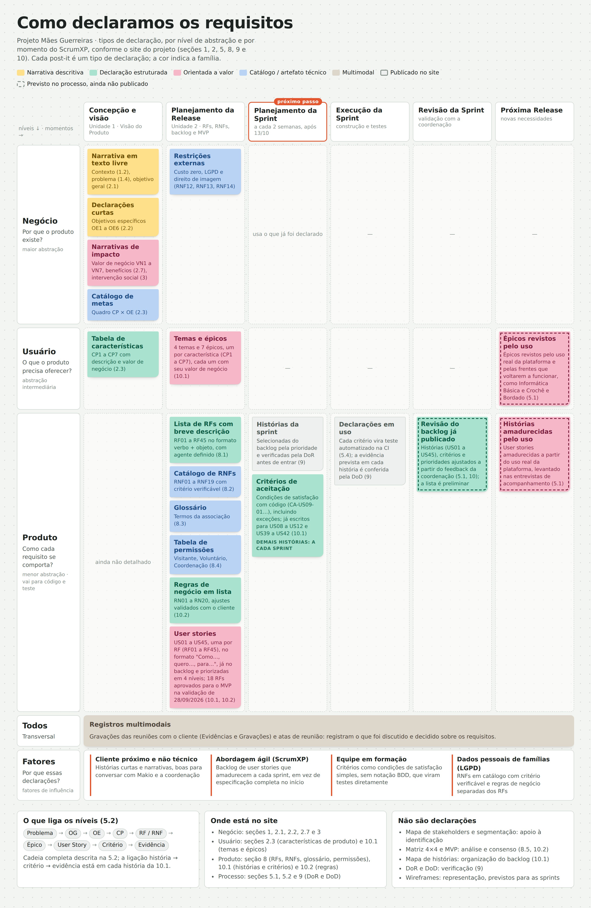

# 5. Engenharia de Requisitos

A partir das informações apresentadas nas seções anteriores, foram estabelecidas as atividades da
Engenharia de Requisitos (ER), suas práticas e técnicas, em alinhamento ao processo ScrumXP definido
na seção [4](../04-estrategias/index.md). Como a operação da associação é predominantemente manual
e conduzida por voluntárias com pouco tempo disponível, foram priorizadas técnicas de contato direto
(entrevistas e brainstorming) e de análise dos registros já existentes, viáveis dentro da disponibilidade
real da equipe e da coordenação.

Ao longo desta seção, distingue-se **prática** (o objetivo exercido, ex.: priorizar requisitos), **técnica**
(o método concreto usado para isso, ex.: MoSCoW) e **artefato/resultado** (o produto gerado pela
técnica, ex.: backlog priorizado). O backlog, os épicos, as user stories, os critérios de aceitação e os
wireframes citados abaixo são tratados como artefatos — resultado de uma técnica — e não como
técnicas em si.

## 5.1 Atividades e Técnicas da ER e ScrumXP

### Planejamento da Release

**Elicitação e Descoberta:**

- **Entrevistas:** entrevistas com Daiane e com as demais coordenadoras (Maria Guerra, Luzia, Liz e
  Cleide) para entender como funcionam hoje o registro das doações de itens em caderno, o cadastro das
  famílias e a chamada em papel.
- **Análise Documental:** analisar os cadernos de doações, o cadastro existente no computador da
  sede e as listas de chamada em papel ajuda a identificar quais dados já são coletados e em que
  formato, a partir de cópias ou fotografias dos registros compartilhadas por Daiane ou Makio.
- **Brainstorming:** sessões com a equipe e a coordenação para levantar ideias sobre o portal
  institucional, o registro de doações de itens e os relatórios desejados pelos parceiros.

**Análise e Consenso:**

- **Priorização MoSCoW:** classificar as funcionalidades em Must have, Should have, Could have e
  Won't have, considerando que o registro das doações de itens e a agenda pública são as dores mais urgentes
  relatadas.
- **Análise de Custo/Benefício:** avaliar o esforço de desenvolvimento e o aprendizado necessário
  frente ao benefício de cada funcionalidade, já que o projeto é pro bono e o prazo é de um semestre.

**Declaração:**

- **Temas, Épicos e User Stories:** organizar os requisitos em temas (portal institucional, doações de itens,
  cadastro e presença, relatórios e acessos), usando os termos que a associação já emprega, como
  Sacola Verde, senha, rodízio e Domingo Recreativo. Os temas, épicos e histórias resultantes são, ao
  mesmo tempo, a declaração do requisito e a estrutura usada para organizar o backlog.

### Planejamento da Sprint

**Elicitação e Descoberta:**

- **Entrevistas:** conversas pontuais com a coordenadora responsável pela frente tratada na sprint,
  para detalhar regras como a das 3 faltas seguidas sem justificativa e o rodízio mensal do Domingo
  Recreativo.
- **Análise de Tarefas:** analisar as etapas realizadas pelas coordenadoras para registrar uma doação de itens, realizar a chamada ou organizar o atendimento, identificando dificuldades, decisões e oportunidades de simplificação.
- **Análise Documental:** revisar os registros existentes daquela frente (caderno de doações, lista de
  chamada) para detalhar campos e formatos antes de implementar.

**Análise e Consenso:**

- **Spike Técnico:** investigação técnica curta e prática, conduzida pela dupla envolvida na história,
  para resolver dependências técnicas antes da sprint começar, como o controle de perfis de acesso
  das coordenadoras e o armazenamento seguro dos dados das famílias.

**Declaração:**

- **Especificação de Critérios de Aceitação (Given-When-Then):** definir critérios objetivos para cada
  user story, incluindo o tempo máximo aceitável para registrar uma doação, requisito crítico, já que a
  falta de tempo é a principal causa dos registros perdidos hoje. Os critérios de aceitação são o
  artefato produzido por essa técnica.

**Organização e Atualização:**

- **Refinamento do Backlog (Backlog Grooming):** refinar o backlog com a equipe e com Daiane, ajustando
  prioridades conforme as necessidades que surgem no dia a dia da associação. O backlog atualizado é
  o artefato gerido por essa técnica.

### Execução da Sprint

**Representação:**

- **Prototipação de Baixa Fidelidade (Wireframing):** criar protótipos das telas do painel administrativo
  e do portal e validá-los com as coordenadoras antes de programar, já que a simplicidade da interface
  é condição para que a ferramenta substitua o caderno. Os wireframes são o artefato produzido por
  essa técnica.

**Verificação e Validação:**

- **Checklist, Revisão de Critérios de Aceitação e Critério INVEST:** verificar se os requisitos estão
  claros, consistentes, completos e testáveis, utilizando checklists, critérios de aceitação e o modelo
  INVEST (Independente, Negociável, Valiosa, Estimável, Pequena, Testável) como critério de qualidade
  das histórias, com atenção especial à proteção dos dados pessoais e ao desempenho do registro de
  doações de itens.

**Organização e Atualização:**

- **Acompanhamento do Backlog da Sprint:** manter os requisitos atualizados e alinhados aos
  objetivos da sprint, permitindo ajustes rápidos diante de obstáculos técnicos ou de novas demandas
  da coordenação. Realizado por meio de reuniões diárias curtas (daily) entre a equipe, com
  atualização do quadro de tarefas.

### Revisão da Sprint

**Verificação e Validação:**

- **Teste com Usuárias Reais:** apresentar as funcionalidades a Daiane e às demais coordenadoras e
  pedir que elas próprias executem a tarefa (registrar uma doação de itens, fazer uma chamada),
  verificando se conseguem fazê-la sem ajuda.

**Análise e Consenso:**

- **Negociação das Alterações:** analisar o feedback recebido e negociar com a coordenação quais
  mudanças serão incorporadas, adiadas ou retiradas do escopo.

**Organização e Atualização:**

- **Revisão das Histórias, Critérios de Aceitação e Prioridades:** revisar as histórias de usuário, os
  critérios de aceitação e as prioridades a partir do feedback, respeitando o escopo do MVP definido na
  seção [2.6](../02-solucao/index.md#26-viabilidade-da-proposta).

### Retrospectiva da Sprint

**Análise e Consenso:**

- **Análise de Causas e Resolução de Conflitos:** analisar problemas relacionados à compreensão,
  declaração e validação dos requisitos, identificando ambiguidades, conflitos e dificuldades de
  comunicação com a coordenação. Conduzida no formato Start/Stop/Continue, por ser simples de
  aplicar em um grupo pequeno e rápido de repetir a cada sprint.

**Organização e Atualização:**

- **Ações de Melhoria do Processo de Requisitos:** ajustar a forma de registrar, priorizar, rastrear e
  atualizar os requisitos com base nas melhorias identificadas durante a retrospectiva.

### Planejamento da Próxima Release

**Elicitação e Descoberta:**

- **Entrevistas de Acompanhamento e Análise de Domínio de Negócio:** conversas de acompanhamento
  com a coordenação para identificar novas necessidades a partir do uso real da plataforma e de
  frentes que voltarem a funcionar, como a Informática Básica e o Crochê e Bordado.

**Análise e Consenso:**

- **Priorização MoSCoW, Mapeamento de Valor:** priorizar as funcionalidades da próxima release
  considerando o valor para a associação e para seus parceiros institucionais.

**Declaração:**

- **Criação de Épicos e User Stories:** criar épicos e user stories detalhando os novos requisitos
  levantados. A qualidade das histórias criadas é verificada posteriormente pelo critério INVEST,
  já aplicado na atividade de Verificação e Validação da Execução da Sprint.

**Organização e Atualização:**

- **Revisão do Backlog da Release:** revisar os requisitos da release, mantendo suas prioridades,
  fontes, dependências e critérios de aceitação atualizados para o próximo ciclo.

## 5.2 Rastreabilidade dos Requisitos

Para que cada requisito possa ser rastreado desde o problema que lhe deu origem até a sua validação, a equipe adota a seguinte cadeia de rastreabilidade, ligando artefatos já definidos nas demais seções do projeto:

Problema ([1.4](../01-cenario/index.md)) → Objetivo Geral ([2.1](../02-solucao/index.md)) → Objetivo Específico ([2.2](../02-solucao/index.md#22-objetivos-especificos-oe-do-produto)) → Característica de Produto ([2.3](../02-solucao/index.md#23-caracteristicas-de-produto)) → Requisito Funcional / Não Funcional ([8.1](../08-requisitos/index.md#81-lista-de-requisitos-funcionais-rfs), [8.2](../08-requisitos/index.md#82-lista-de-requisitos-nao-funcionais-rnfs)) → Tema e Épico ([10.1](../10-backlog/index.md#101-backlog-geral)) → User Story ([10.1](../10-backlog/index.md#101-backlog-geral)) → Critério de Aceitação → Evidência de Validação

- Cada problema identificado na seção [1.4](../01-cenario/index.md) é atendido por um ou mais Objetivos Específicos, que detalham o Objetivo Geral do produto (seção [2.1](../02-solucao/index.md)).
- Cada Objetivo Específico (seção [2.2](../02-solucao/index.md#22-objetivos-especificos-oe-do-produto)) se conecta a uma ou mais Características de Produto (CP1 a CP7, seção [2.3](../02-solucao/index.md#23-caracteristicas-de-produto)).
- Cada característica de produto origina requisitos funcionais e não funcionais, incluindo RNFs decorrentes dos efeitos emergentes identificados na seção [3](../03-intervencao-social/index.md), como privacidade e proteção de dados pessoais. A ligação de cada RF com sua CP, seu agente e seus RNFs está na matriz da seção [8.4](../08-requisitos/index.md).
- Cada característica de produto é um épico dentro de um dos quatro temas do backlog, e cada RF é declarado como uma user story com o mesmo número (RF01 → US01), conforme a seção [10.1](../10-backlog/index.md#101-backlog-geral).
- Cada user story recebe critérios de aceitação, escritos como lista de condições de satisfação, antes de entrar em uma sprint, conforme a Definição de Preparado (seção [9](../09-dor-dod/index.md)), e as regras de negócio que ela aplica ficam registradas na lista de regras da seção [10.2](../10-backlog/index.md#102-priorizacao-do-backlog-geral-e-mvp).
- Cada critério de aceitação é validado por uma evidência concreta: teste automatizado, teste com usuária real ou registro da revisão da sprint com Makio ou Daiane, conforme a Definição de Pronto (seção [9](../09-dor-dod/index.md)).

### Do problema às características de produto

| Problema identificado (1.4) | Objetivo Específico (2.2) | Característica de Produto (2.3) |
| :--- | :--- | :--- |
| Doações de itens anotadas em cadernos e, por falta de tempo, nem sempre registradas | OE2 | CP2 – Registro de doações de itens |
| Não existe relatório organizado do que foi recebido e distribuído | OE5 | CP6 – Relatórios e indicadores de impacto |
| A prestação de contas aos parceiros depende da memória das coordenadoras | OE5 | CP6 – Relatórios e indicadores de impacto |
| O cadastro das famílias fica em um computador da sede, sem ligação com a presença e as doações | OE3 | CP3 – Cadastro de famílias e participantes; CP4 – Inscrição em atividades |
| A chamada é feita em papel e a regra de faltas depende de conferência manual | OE4 | CP5 – Chamada digital e controle de frequência |
| A Sacola Verde não registra quem foi atendido em cada distribuição | OE2 (parcial) | CP2 – a saída de itens para a família fica registrada no RF10; o sistema de senhas ficou fora do escopo (seção [11](../08-licoes/index.md), Unidade 1) |
| A comunidade não sabe quais atividades estão ativas, suspensas ou dependem de doação | OE1 | CP1 – Portal institucional e agenda de atividades |
| Informações institucionais e vagas dependem de Instagram, panfletos e grupos de WhatsApp | OE1 | CP1 – Portal institucional e agenda de atividades |
| Tratamento de dados pessoais de famílias em vulnerabilidade (efeito emergente, seção [3](../03-intervencao-social/index.md)) | OE6 | CP7 – Perfis de acesso e proteção de dados |

### Das características de produto às user stories

| OE | CP / Épico | Tema | RFs → User Stories | RNFs específicos | No MVP |
| :--- | :--- | :--- | :--- | :--- | :--- |
| OE1, OE5 | CP1 – Portal institucional e agenda de atividades | Portal institucional | RF01 a RF07 → US01 a US07 | RNF03, RNF07, RNF13 | — |
| OE2, OE5 | CP2 – Registro de doações de itens | Doações de itens | RF08 a RF13 → US08 a US13 | RNF01, RNF03, RNF19 | US08 a US12 |
| OE3, OE6 | CP3 – Cadastro de famílias e participantes | Cadastro e presença | RF14 a RF19 → US14 a US19 | RNF03, RNF07, RNF13, RNF16, RNF19 | US14, US16, US18, US19 |
| OE3 | CP4 – Inscrição em atividades e organização do atendimento | Cadastro e presença | RF20 a RF26 → US20 a US26 | RNF03, RNF07 | US20, US23, US26 |
| OE4, OE5 | CP5 – Chamada digital e controle de frequência | Cadastro e presença | RF27 a RF32 → US27 a US32 | RNF01, RNF03, RNF07, RNF10, RNF16, RNF19 | US27, US28 |
| OE5 | CP6 – Relatórios e indicadores de impacto | Relatórios e acessos | RF33 a RF38 → US33 a US38 | RNF03, RNF07 | — |
| OE6 | CP7 – Perfis de acesso e proteção de dados | Relatórios e acessos | RF39 a RF45 → US39 a US45 | RNF07, RNF13, RNF14, RNF15, RNF19 | US39 a US42 |

Os RNF02, RNF04, RNF05, RNF06, RNF08, RNF09, RNF11, RNF12, RNF17 e RNF18 valem para todas as características (seção [8.4](../08-requisitos/index.md)).

### Exemplo da cadeia completa

A tabela a seguir mostra a cadeia completa para uma história do MVP. As demais histórias seguem o mesmo modelo e terão critérios e evidências registrados a cada sprint.

| Problema | OE | CP / Épico | RF / RNF | User Story | Regra de negócio | Critério de Aceitação | Evidência de Validação |
| :--- | :--- | :--- | :--- | :--- | :--- | :--- | :--- |
| Doações anotadas em cadernos e nem sempre registradas | OE2 | CP2 – Registro de doações de itens | RF09 – Registrar doação recebida; RNF01, RNF19 | US09 – Como voluntário, quero registrar a entrada de itens doados com categoria, quantidade, data e doador, para que nenhuma doação recebida deixe de ser registrada. | RN02 – a quantidade usa a unidade de medida da categoria | (1) O voluntário autenticado consegue informar categoria cadastrada, quantidade, data e doador e confirmar o registro; (2) a entrada registrada aparece na consulta de saldo (US12) com a quantidade somada | Teste automatizado no pipeline de CI e teste com uma voluntária, sem apoio da equipe, na revisão da Sprint 5 |

## 5.3 Engenharia de Requisitos e o ScrumXP

O quadro a seguir apresenta o mapeamento das atividades, práticas e técnicas da ER aos momentos do processo ScrumXP definido para a condução do projeto.

| Momentos do ScrumXP | Atividades da ER | Prática | Técnica | Resultados Esperados |
| :--- | :--- | :--- | :--- | :--- |
| Planejamento da Release | Elicitação e Descoberta | Levantamento de Requisitos | Entrevistas, Questionário, Análise Documental, Brainstorming | Rotinas manuais da associação compreendidas e requisitos de alto nível identificados. |
| Planejamento da Release | Análise e Consenso | Priorização de Requisitos | Priorização MoSCoW, Matriz de Valor de Negócio × Esforço Técnico (4 × 4) | MVP de 18 RFs validado com Makio em 28/09/2026 (seção [10.2](../10-backlog/index.md#102-priorizacao-do-backlog-geral-e-mvp)): doações (CP2), famílias e participantes (CP3), turma e inscrição (parte do CP4), chamada (CP5) e acesso e consentimento (parte do CP7). Portal (CP1) e relatórios (CP6) ficam para depois do MVP. |
| Planejamento da Release | Declaração | Especificação dos Requisitos | Lista de RFs e RNFs, Temas, Épicos e User Stories | RFs e RNFs declarados (seção [8](../08-requisitos/index.md)) e backlog de 45 user stories organizado em 4 temas e 7 épicos (seção [10.1](../10-backlog/index.md#101-backlog-geral)), com o vocabulário usado pela associação. |
| Planejamento da Release | Organização e Atualização | Organização do Backlog | Mapa de Histórias, Matriz de Rastreabilidade | Histórias organizadas em fatias de entrega com a linha do MVP (seção [10.1](../10-backlog/index.md#101-backlog-geral)) e rastreadas do problema à história (seção [5.2](#52-rastreabilidade-dos-requisitos)). |
| Planejamento da Sprint | Elicitação e Descoberta | Refinamento de Requisitos | Entrevistas, Análise Documental, Análise de Tarefas | Requisitos refinados a partir das rotinas reais das coordenadoras e preparados para a sprint. |
| Planejamento da Sprint | Análise e Consenso | Análise de Dependências e Viabilidade | Spike Técnico | Consenso sobre dependências, viabilidade técnica e prioridades da sprint. |
| Planejamento da Sprint | Declaração | Definição de Critérios de Aceitação e Regras de Negócio | Lista de Condições de Satisfação, Lista de Regras de Negócio | User stories com critérios de aceitação e regras de negócio registradas na lista da seção [10.2](../10-backlog/index.md#102-priorizacao-do-backlog-geral-e-mvp). |
| Planejamento da Sprint | Verificação e Validação | Verificação da Prontidão | Checklist da Definição de Preparado (DoR), Critério INVEST | Apenas histórias que passam em todos os itens da DoR (seção [9](../09-dor-dod/index.md)) entram na sprint. |
| Planejamento da Sprint | Organização e Atualização | Refinamento dos Requisitos | Backlog Grooming | Backlog refinado com a coordenação antes do início da sprint. |
| Execução da Sprint | Representação | Criação de Protótipos | Prototipação de Baixa Fidelidade (Wireframing) | Wireframes, o artefato produzido, validados com usuárias de baixa familiaridade digital. |
| Execução da Sprint | Verificação e Validação | Verificação dos Requisitos | Checklist, Revisão de Critérios de Aceitação, Critério INVEST | Requisitos e histórias verificados quanto à clareza, consistência, completude e testabilidade. |
| Execução da Sprint | Organização e Atualização | Acompanhamento do Backlog | Reuniões Diárias (Daily) | Backlog atualizado e alinhado com os objetivos da sprint em andamento. |
| Revisão da Sprint | Verificação e Validação | Verificação da Conclusão | Checklist da Definição de Pronto (DoD) | Só são apresentadas na revisão as histórias que passam em todos os itens da DoD (seção [9](../09-dor-dod/index.md)); as demais voltam ao backlog. |
| Revisão da Sprint | Verificação e Validação | Validação com a Coordenação | Coleta de Feedback, Teste com Usuárias Reais | Requisitos e funcionalidades validados pelas coordenadoras em situações reais de uso, com feedback coletado. |
| Revisão da Sprint | Análise e Consenso | Negociação das Alterações | Análise do Feedback, Negociação | Alterações analisadas e classificadas como incorporadas, adiadas ou retiradas do escopo. |
| Revisão da Sprint | Organização e Atualização | Atualização dos Requisitos | Revisão das Histórias de Usuário, Critérios de Aceitação e Prioridades | Requisitos, backlog e rastreabilidade atualizados conforme o feedback, respeitando o escopo do MVP. |
| Retrospectiva da Sprint | Análise e Consenso | Análise de Problemas da ER | Retrospectiva Start/Stop/Continue | Problemas relacionados aos requisitos e à comunicação identificados e analisados. |
| Retrospectiva da Sprint | Organização e Atualização | Atualização da Organização dos Requisitos | Ações de Melhoria Contínua | Melhorias incorporadas à organização dos requisitos e registradas nas Lições Aprendidas (seção [11](../08-licoes/index.md)). |
| Planejamento da Próxima Release | Elicitação e Descoberta | Identificação de Novos Requisitos | Entrevistas de Acompanhamento, Análise de Domínio de Negócio | Novos requisitos identificados e requisitos existentes revisados a partir do uso real da plataforma. |
| Planejamento da Próxima Release | Análise e Consenso | Priorização Estratégica | Priorização MoSCoW, Matriz de Valor de Negócio × Esforço Técnico | Histórias das fatias 2 e 3 do mapa repriorizadas para a próxima release. |
| Planejamento da Próxima Release | Declaração | Definição de Épicos e User Stories | Criação de Épicos e User Stories | User stories claramente definidas e vinculadas aos objetivos da próxima release. |
| Planejamento da Próxima Release | Organização e Atualização | Revisão do Backlog | Revisão e Reordenação do Backlog, Mapa de Histórias | Backlog e mapa de histórias atualizados e preparados para o próximo ciclo. |

## 5.4 Integração da ER com as Práticas de XP

Além dos eventos do Scrum mapeados acima, a ER se conecta às seis práticas de XP já adotadas pela
equipe (seção [4.4](../04-estrategias/index.md#44-praticas-de-xp-adotadas)):

- **Testes automatizados:** os critérios de aceitação definidos na Declaração da Sprint alimentam a
  escrita dos testes automatizados das funcionalidades críticas.
- **Integração contínua:** o pipeline de CI verifica os critérios de aceitação (RF) e os requisitos não
  funcionais críticos antes de qualquer entrega ser considerada concluída.
- **Design simples:** cada história é implementada da forma mais simples que atenda ao seu critério de
  aceitação, sem antecipar requisitos especulativos.
- **Refatoração contínua:** mudanças de requisito identificadas na Revisão ou Retrospectiva da Sprint
  podem disparar refatorações no código já existente.
- **Programação em pares:** as user stories e seus critérios de aceitação orientam a dupla durante a
  implementação, especialmente nas tarefas de maior risco técnico.
- **Propriedade coletiva do código:** a rastreabilidade descrita na seção [5.2](#52-rastreabilidade-dos-requisitos)
  permite que qualquer integrante entenda o requisito por trás de um trecho de código que não
  escreveu.

## 5.5 Declaração dos Requisitos

Esta seção reúne, em um só lugar, como a equipe declara os requisitos: quais tipos de declaração
são usados, em que nível de abstração (negócio, usuário ou produto) e em que momento do ScrumXP
cada um aparece. O quadro abaixo mostra cada tipo de declaração como um post-it, colorido pela
família a que pertence (narrativa, estruturada, orientada a valor, catálogo ou multimodal).
Post-its com borda tracejada são declarações previstas no processo que ainda não foram
produzidas.

### Tipos de declaração por nível

| Nível | O que responde | Tipos de declaração usados | Onde está no site |
| :--- | :--- | :--- | :--- |
| Negócio | Por que o produto existe? | Narrativa em texto livre (contexto, problema, objetivo geral), declarações curtas (OE1 a OE6), narrativas de impacto (VN1 a VN7) | Seções 1, 2.1, 2.2, 2.7 e 3 |
| Usuário | O que o produto precisa oferecer? | Tabela de características de produto (CP1 a CP7), temas e épicos | Seções 2.3 e 10.1 |
| Produto | Como cada requisito se comporta? | Lista de RFs (verbo + objeto, com agente), catálogo de RNFs com critério verificável, glossário, tabela de permissões, regras de negócio (RN01 a RN20), user stories (US01 a US45) e critérios de aceitação | Seções 8, 10.1 e 10.2 |

Os níveis se ligam pela cadeia de rastreabilidade descrita na seção 5.2: problema → objetivo geral
→ OE → CP → RF/RNF → épico → user story → critério de aceitação → evidência.

### Fatores que influenciaram as escolhas

| Fator de influência | Escolha feita pela equipe |
| :--- | :--- |
| Cliente próximo e sem formação técnica | User stories curtas, no formato "Como..., quero..., para...", fáceis de discutir com Makio e a coordenação nas reuniões de validação. |
| Abordagem ágil (ScrumXP) | Backlog de histórias que amadurecem a cada sprint, em vez de uma especificação completa no início do projeto. Os critérios de aceitação são escritos para as histórias da próxima sprint, e não para o backlog inteiro de uma vez. |
| Equipe em formação | Critérios de aceitação escritos como condições de satisfação simples e numeradas (por exemplo, CA-US09-01), sem notação BDD, que podem virar testes automatizados diretamente (seção 5.4). |
| Dados pessoais de famílias e crianças (LGPD) | RNFs declarados em catálogo, cada um com critério verificável, e regras de negócio separadas do texto dos RFs, para que possam ser verificadas e alteradas sem reescrever os requisitos. |

### O que não é declaração

Alguns artefatos do site apoiam a Engenharia de Requisitos, mas não declaram requisitos: o mapa
de stakeholders (apoio à identificação), a matriz de valor × esforço e o MVP (análise e consenso,
seções 8.5 e 10.2), o mapa de histórias (organização do backlog, seção 10.1) e a DoR e a DoD
(verificação, seção 9).
