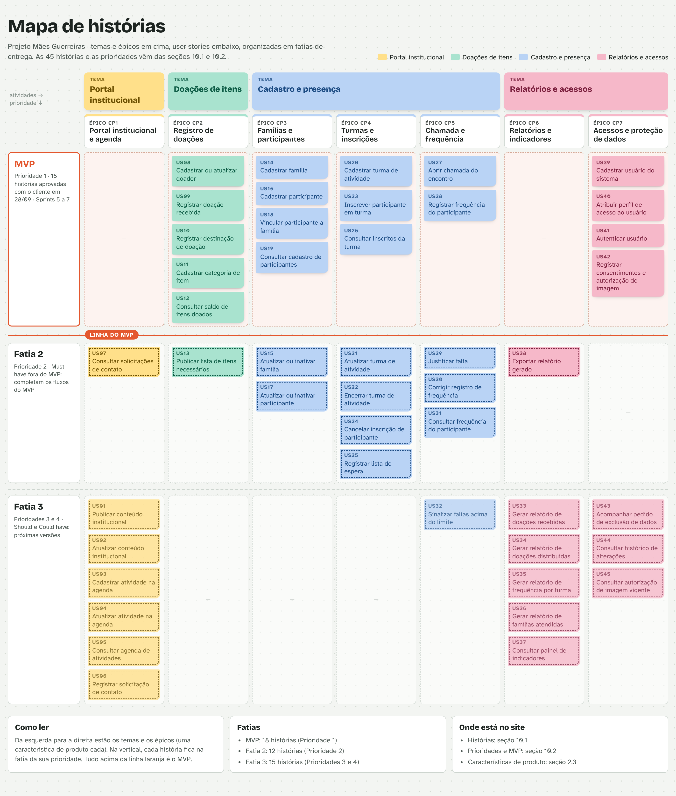

# 10. Backlog de Produto

Todas as user stories (US) desta seção derivam da lista de requisitos funcionais da seção
[8.1](../08-requisitos/index.md#81-lista-de-requisitos-funcionais-rfs): cada RF gera uma US com o
mesmo número (RF01 → US01). Esta é uma lista preliminar e será ajustada sempre que necessário
durante o desenvolvimento, a partir do feedback da coordenação nas revisões de sprint (seção 5.1).
Antes de entrar em uma sprint, cada US precisa atender à Definição de Preparado (DoR) da seção
[9](../09-dor-dod/index.md), o que inclui ter os critérios de aceitação escritos.

## 10.1 Backlog Geral

A tabela a seguir apresenta cada requisito funcional declarado com a técnica de user story, no
formato "Como [perfil], quero [ação], para [benefício]", e a rastreabilidade com os requisitos não
funcionais. As histórias estão organizadas nos quatro temas definidos na seção 5.1; dentro de cada
tema, cada característica de produto (CP) da seção 2.3 é um épico, e o benefício de cada história
segue o valor de negócio (VN) da sua característica.

**Observações:**

- Os RNF05, RNF06, RNF08, RNF09, RNF11, RNF12, RNF17 e RNF18 valem para todas as histórias
  (seção 8.4). A coluna "RNFs relacionados" lista só os que se aplicam de forma específica.
- Quando o RF permite o uso por Voluntário e por Coordenação, a história é escrita do ponto de vista
  do voluntário, porque a Coordenação tem todas as permissões do Voluntário (tabela de permissões da
  seção 8.4).
- As histórias marcadas com **MVP** são as 18 aprovadas com o cliente em 28/09/2026 (seção 10.2).

### Tema: Portal institucional

**Épico CP1 – Portal institucional e agenda de atividades** (VN1: centralizar as informações destinadas à comunidade e aos apoiadores)

| RF | User Story derivada | RNFs relacionados |
| :--- | :--- | :--- |
| RF01 – Publicar conteúdo institucional | **US01** – Como membro da coordenação, quero publicar o histórico, a missão, o endereço e as formas de contato da associação na área pública, para que a comunidade e os apoiadores encontrem essas informações em um só lugar. | — |
| RF02 – Atualizar conteúdo institucional | **US02** – Como membro da coordenação, quero alterar o histórico, a missão, o endereço e as formas de contato publicados, para manter corretas as informações públicas da associação. | — |
| RF03 – Cadastrar atividade na agenda | **US03** – Como membro da coordenação, quero cadastrar uma atividade com data, horário, local e público a que se destina, para divulgar as oficinas e os eventos da associação. | — |
| RF04 – Atualizar atividade na agenda | **US04** – Como membro da coordenação, quero alterar ou cancelar uma atividade já divulgada, para que ninguém compareça com base em informação desatualizada. | — |
| RF05 – Consultar agenda de atividades | **US05** – Como visitante, quero consultar as atividades divulgadas, filtrando por período e por tipo, para saber quando e onde posso participar. | RNF03 |
| RF06 – Registrar solicitação de contato | **US06** – Como visitante, quero enviar uma solicitação de contato com meu nome, um telefone ou e-mail e uma mensagem, para ser atendido pela coordenação sem precisar ir até a associação. | RNF13 |
| RF07 – Consultar solicitações de contato | **US07** – Como membro da coordenação, quero consultar as solicitações de contato e marcar cada uma como atendida, para que nenhum pedido da comunidade fique sem resposta. | RNF07, RNF13 |

### Tema: Doações de itens

**Épico CP2 – Registro de doações de itens** (VN2: reduzir doações não registradas e dar visibilidade aos itens recebidos e distribuídos)

| RF | User Story derivada | RNFs relacionados |
| :--- | :--- | :--- |
| RF08 – Cadastrar ou atualizar doador | **US08** (MVP) – Como voluntário, quero cadastrar e, se necessário, corrigir os dados de pessoas e organizações que doam itens, para saber de onde veio cada doação. | RNF01 |
| RF09 – Registrar doação recebida | **US09** (MVP) – Como voluntário, quero registrar a entrada de itens doados com categoria, quantidade, data e doador, para que nenhuma doação recebida deixe de ser registrada. | RNF01, RNF19 |
| RF10 – Registrar destinação de doação | **US10** (MVP) – Como voluntário, quero registrar a saída de itens doados com categoria, quantidade, data e a família ou atividade que os recebeu, para saber para onde foi cada doação. | RNF19 |
| RF11 – Cadastrar categoria de item | **US11** (MVP) – Como membro da coordenação, quero cadastrar categorias de item com nome e unidade de medida, para que as entradas e saídas sejam contadas sempre da mesma forma. | — |
| RF12 – Consultar saldo de itens doados | **US12** (MVP) – Como voluntário, quero consultar a quantidade atual de cada item doado, por categoria, para saber o que há disponível antes de fazer uma distribuição. | RNF03 |
| RF13 – Publicar lista de itens necessários | **US13** – Como membro da coordenação, quero incluir e remover na área pública os itens de que a associação precisa no momento, para orientar os apoiadores sobre o que doar. | RNF03 |

### Tema: Cadastro e presença

**Épico CP3 – Cadastro de famílias e participantes** (VN3: centralizar os dados hoje mantidos de forma isolada)

| RF | User Story derivada | RNFs relacionados |
| :--- | :--- | :--- |
| RF14 – Cadastrar família | **US14** (MVP) – Como voluntário, quero cadastrar uma família atendida com o nome do responsável, telefone e endereço, para reunir em um só lugar os dados das famílias acompanhadas. | RNF07, RNF13, RNF16, RNF19 |
| RF15 – Atualizar ou inativar cadastro de família | **US15** – Como voluntário, quero atualizar os dados de uma família, e, como membro da coordenação, quero inativá-la, para manter o cadastro em dia sem perder o histórico de atendimento. | RNF07, RNF13, RNF19 |
| RF16 – Cadastrar participante | **US16** (MVP) – Como voluntário, quero cadastrar um participante com nome completo e data de nascimento, para registrar cada pessoa atendida pela associação. | RNF07, RNF13, RNF16, RNF19 |
| RF17 – Atualizar ou inativar cadastro de participante | **US17** – Como voluntário, quero atualizar os dados de um participante, e, como membro da coordenação, quero inativá-lo, para manter o cadastro em dia, liberar as vagas que ele ocupava e preservar o histórico. | RNF07, RNF13, RNF19 |
| RF18 – Vincular participante a família | **US18** (MVP) – Como voluntário, quero vincular o participante à sua família e indicar o responsável legal, para saber quem responde por cada criança ou adolescente atendido. | RNF07, RNF13 |
| RF19 – Consultar cadastro de participantes | **US19** (MVP) – Como voluntário, quero buscar participantes por nome, família ou atividade, para encontrar o cadastro rapidamente durante o atendimento. | RNF03, RNF07 |

**Épico CP4 – Inscrição em atividades e organização do atendimento** (VN4: organizar e rastrear os atendimentos realizados)

| RF | User Story derivada | RNFs relacionados |
| :--- | :--- | :--- |
| RF20 – Cadastrar turma de atividade | **US20** (MVP) – Como membro da coordenação, quero cadastrar uma turma com atividade, período, dias de encontro e quantidade de vagas, para organizar a oferta das oficinas. | — |
| RF21 – Atualizar turma de atividade | **US21** – Como membro da coordenação, quero alterar o período, os dias de encontro e as vagas de uma turma em andamento, para ajustar a oferta sem prejudicar quem já está inscrito. | — |
| RF22 – Encerrar turma de atividade | **US22** – Como membro da coordenação, quero encerrar uma turma registrando a data, para manter o histórico das turmas realizadas. | — |
| RF23 – Inscrever participante em turma | **US23** (MVP) – Como voluntário, quero inscrever um participante ativo em uma turma com vaga, para registrar quem frequenta cada atividade. | — |
| RF24 – Cancelar inscrição de participante | **US24** – Como voluntário, quero cancelar uma inscrição informando o motivo, para liberar a vaga e saber por que o participante saiu. | — |
| RF25 – Registrar participante em lista de espera | **US25** – Como voluntário, quero registrar o participante na lista de espera de uma turma sem vaga, para que ele seja chamado na ordem de registro quando abrir uma vaga. | — |
| RF26 – Consultar inscritos da turma | **US26** (MVP) – Como voluntário, quero consultar os inscritos e a lista de espera de cada turma, para saber quem participa e quem aguarda vaga. | RNF03, RNF07 |

**Épico CP5 – Chamada digital e controle de frequência** (VN5: reduzir a conferência manual de presença e apoiar a regra de faltas)

| RF | User Story derivada | RNFs relacionados |
| :--- | :--- | :--- |
| RF27 – Abrir chamada do encontro | **US27** (MVP) – Como voluntário, quero abrir a chamada de um encontro com a lista de inscritos da turma, para registrar a presença no próprio dia, sem lista em papel. | RNF01, RNF10, RNF16 |
| RF28 – Registrar frequência do participante | **US28** (MVP) – Como voluntário, quero marcar cada participante da chamada como presente ou ausente, para acabar com a conferência manual da presença. | RNF01, RNF10, RNF16 |
| RF29 – Justificar falta | **US29** – Como voluntário, quero informar o motivo de uma falta já registrada, para que a falta justificada não conte para o limite de faltas. | RNF01, RNF16 |
| RF30 – Corrigir registro de frequência | **US30** – Como voluntário que fez a chamada, quero corrigir um registro até o fim do mesmo dia, e, como membro da coordenação, quero corrigir a qualquer momento informando o motivo, para corrigir erros sem perder o registro anterior. | RNF19 |
| RF31 – Consultar frequência do participante | **US31** – Como voluntário, quero consultar o histórico de presenças e faltas de um participante por turma e por período, para acompanhar a participação dele. | RNF03, RNF07 |
| RF32 – Sinalizar participante com faltas acima do limite | **US32** – Como membro da coordenação, quero que o sistema sinalize o participante que atingir o limite de faltas não justificadas, para entrar em contato com a família a tempo. | RNF07 |

### Tema: Relatórios e acessos

**Épico CP6 – Relatórios e indicadores de impacto** (VN6: apoiar a prestação de contas e a captação de novos apoiadores)

| RF | User Story derivada | RNFs relacionados |
| :--- | :--- | :--- |
| RF33 – Gerar relatório de doações recebidas | **US33** – Como membro da coordenação, quero gerar o relatório dos itens recebidos por período, categoria e doador, para prestar contas aos apoiadores. | RNF03 |
| RF34 – Gerar relatório de doações distribuídas | **US34** – Como membro da coordenação, quero gerar o relatório dos itens destinados por período, categoria e família atendida, para mostrar como as doações foram distribuídas. | RNF03, RNF07 |
| RF35 – Gerar relatório de frequência por turma | **US35** – Como membro da coordenação, quero gerar o relatório de presenças e faltas de uma turma por período ou de um encontro, para acompanhar a participação nas atividades. | RNF03, RNF07 |
| RF36 – Gerar relatório de famílias atendidas | **US36** – Como membro da coordenação, quero gerar o relatório das famílias com atendimento registrado no período, para demonstrar o alcance da associação. | RNF03, RNF07 |
| RF37 – Consultar painel de indicadores | **US37** – Como membro da coordenação, quero consultar um painel com famílias atendidas, participantes ativos, itens recebidos e distribuídos e participantes sinalizados, para acompanhar o impacto da associação em um só lugar. | RNF03 |
| RF38 – Exportar relatório gerado | **US38** – Como membro da coordenação, quero exportar um relatório em PDF ou CSV, para enviá-lo a apoiadores e usá-lo em planilhas. | RNF03 |

**Épico CP7 – Perfis de acesso e proteção de dados** (VN7: proteger os dados das famílias atendidas e cumprir a LGPD)

| RF | User Story derivada | RNFs relacionados |
| :--- | :--- | :--- |
| RF39 – Cadastrar usuário do sistema | **US39** (MVP) – Como membro da coordenação, quero cadastrar voluntários e outros membros da coordenação, para que só pessoas autorizadas usem a área restrita. | RNF07, RNF15 |
| RF40 – Atribuir perfil de acesso ao usuário | **US40** (MVP) – Como membro da coordenação, quero atribuir a cada usuário o perfil Voluntário ou Coordenação, para que cada pessoa acesse apenas o que sua função permite. | RNF07 |
| RF41 – Autenticar usuário | **US41** (MVP) – Como voluntário, quero entrar na área restrita com meu usuário e senha, para usar as funções do meu perfil com segurança. | RNF07, RNF15 |
| RF42 – Registrar consentimentos e autorizações (LGPD e Imagem) | **US42** (MVP) – Como voluntário, quero registrar o consentimento do titular (ou responsável legal) para as finalidades de tratamento de dados pessoais e a autorização de uso de imagem, para garantir a conformidade legal das ações da associação. | RNF13, RNF14 |
| RF43 – Registrar e acompanhar solicitação de exclusão de dados | **US43** – Como membro da coordenação, quero registrar e acompanhar as etapas de uma solicitação de exclusão de dados, para responder ao titular conforme a LGPD. | RNF13 |
| RF44 – Consultar histórico de alterações de cadastro | **US44** – Como membro da coordenação, quero consultar quem alterou dados pessoais ou registros de frequência, o que foi alterado e quando, para ter controle sobre as alterações feitas no sistema. | RNF07, RNF19 |
| RF45 – Consultar autorização de uso de imagem vigente | **US45** – Como voluntário, quero consultar, por pessoa, a autorização de imagem em vigor para cada meio, para não divulgar uma imagem sem permissão. | RNF14 |

### Mapa de histórias

O mapa a seguir organiza as user stories por tema e épico (na horizontal) e por fatia de entrega
(na vertical). Tudo o que fica acima da linha do MVP compõe o núcleo validado com o cliente;
as fatias 2 e 3 seguem as prioridades da seção [10.2](index.md#102-priorizacao-do-backlog-geral-e-mvp).

## 10.2 Priorização do Backlog Geral e MVP

A priorização considerou duas perspectivas complementares: o **valor de negócio**, avaliado com a
participação do cliente, e o **esforço técnico**, avaliado pela equipe. Os resultados foram
cruzados na matriz 4 × 4 (seção [8.5](../08-requisitos/index.md#85-matriz-4x4)).

### Critérios e escala de avaliação do valor de negócio

A equipe adotou o método MoSCoW, associado a uma escala numérica de 1 a 4:

| Pontuação | Classificação | Interpretação |
| :--- | :--- | :--- |
| 4 | Must have | Indispensável para resolver o problema central ou viabilizar o produto |
| 3 | Should have | Muito importante, mas o produto ainda pode operar temporariamente sem o requisito |
| 2 | Could have | Agrega valor, mas pode ser adiado sem comprometer o objetivo principal |
| 1 | Won't have now | Não é prioritário para a versão atual |

### Critérios e escala de avaliação do esforço técnico

A avaliação técnica considerou três critérios, cada um em uma escala de 1 a 4: esforço de
implementação, complexidade técnica e lacuna de capacidade da equipe (domínio das tecnologias
envolvidas). O esforço técnico consolidado de cada RF é a média dos três critérios, arredondada
para a escala de 1 a 4.

| Pontuação | Esforço | Complexidade | Lacuna de capacidade |
| :--- | :--- | :--- | :--- |
| 1 | Até 2 horas | Baixa | A equipe domina plenamente os conhecimentos necessários |
| 2 | Entre 2 e 6 horas | Moderada | A equipe possui conhecimento suficiente, com pouca aprendizagem adicional |
| 3 | Entre 6 e 12 horas | Alta | A equipe precisa desenvolver conhecimentos relevantes |
| 4 | Mais de 12 horas | Muito alta | A equipe ainda não possui os conhecimentos ou recursos necessários |

### Avaliação consolidada dos RFs

A tabela abaixo agrupa os RFs pela combinação de valor de negócio e esforço técnico consolidado
que resultou na matriz 4 × 4. As justificativas de negócio e as decisões de regra associadas a
cada bloco estão detalhadas na validação do MVP, adiante.

| Valor de negócio | Esforço técnico | RFs |
| :--- | :--- | :--- |
| 4 — Must have | 2 — Moderado | RF25 |
| 4 — Must have | 3 — Alto | RF07 a RF24, RF26 a RF31, RF38, RF39, RF40 |
| 3 — Should have | 3 — Alto | RF41, RF42, RF43, RF45 |
| 2 — Could have | 3 — Alto | RF01 a RF06, RF44 |
| 2 — Could have | 4 — Muito alto | RF32 a RF37 |

### Priorização das user stories

Cada user story herda a avaliação do RF de origem: o valor de negócio (escala MoSCoW de 1 a 4) e o
esforço técnico consolidado (escala de 1 a 4) apresentados acima. A partir deles, cada história é
posicionada em um dos quatro quadrantes da matriz de valor × carga técnica:

| Quadrante | Critério | Leitura |
| :--- | :--- | :--- |
| Q1 – Alto valor / Baixa carga técnica | Valor 3 ou 4 e esforço 1 ou 2 | Entregar o quanto antes: muito valor com pouco esforço |
| Q2 – Alto valor / Alta carga técnica | Valor 3 ou 4 e esforço 3 ou 4 | Essencial, mas exige planejamento e divisão em sprints |
| Q3 – Baixo valor / Baixa carga técnica | Valor 1 ou 2 e esforço 1 ou 2 | Encaixar quando sobrar capacidade na sprint |
| Q4 – Baixo valor / Alta carga técnica | Valor 1 ou 2 e esforço 3 ou 4 | Adiar para versões futuras |

A prioridade sugerida combina o quadrante com a decisão de MVP tomada com o cliente:

- **Prioridade 1 – MVP:** as 18 histórias aprovadas na validação de 28/09/2026.
- **Prioridade 2:** histórias com valor 4 (Must have) que não entraram no MVP; são as primeiras
  candidatas depois dele, pois completam fluxos já iniciados no MVP (correção de chamada, lista de
  espera, inativação de cadastros).
- **Prioridade 3:** histórias com valor 3 (Should have) fora do MVP, do bloco de imagem e exclusão
  de dados da LGPD, cuja prioridade ainda será confirmada com a coordenação.
- **Prioridade 4:** histórias com valor 2 (Could have): portal, agenda, relatórios e histórico de
  alterações.

| US | Descrição | RF | Valor de negócio | Esforço técnico | Quadrante | Prioridade sugerida |
| :--- | :--- | :--- | :--- | :--- | :--- | :--- |
| US08 | Cadastrar ou atualizar doador | RF08 | 4 – Must | 3 – Alto | Q2 – Alto valor / Alta carga | Prioridade 1 – MVP |
| US09 | Registrar doação recebida | RF09 | 4 – Must | 3 – Alto | Q2 – Alto valor / Alta carga | Prioridade 1 – MVP |
| US10 | Registrar destinação de doação | RF10 | 4 – Must | 3 – Alto | Q2 – Alto valor / Alta carga | Prioridade 1 – MVP |
| US11 | Cadastrar categoria de item | RF11 | 4 – Must | 3 – Alto | Q2 – Alto valor / Alta carga | Prioridade 1 – MVP |
| US12 | Consultar saldo de itens doados | RF12 | 4 – Must | 3 – Alto | Q2 – Alto valor / Alta carga | Prioridade 1 – MVP |
| US14 | Cadastrar família | RF14 | 4 – Must | 3 – Alto | Q2 – Alto valor / Alta carga | Prioridade 1 – MVP |
| US16 | Cadastrar participante | RF16 | 4 – Must | 3 – Alto | Q2 – Alto valor / Alta carga | Prioridade 1 – MVP |
| US18 | Vincular participante a família | RF18 | 4 – Must | 3 – Alto | Q2 – Alto valor / Alta carga | Prioridade 1 – MVP |
| US19 | Consultar cadastro de participantes | RF19 | 4 – Must | 3 – Alto | Q2 – Alto valor / Alta carga | Prioridade 1 – MVP |
| US20 | Cadastrar turma de atividade | RF20 | 4 – Must | 3 – Alto | Q2 – Alto valor / Alta carga | Prioridade 1 – MVP |
| US23 | Inscrever participante em turma | RF23 | 4 – Must | 3 – Alto | Q2 – Alto valor / Alta carga | Prioridade 1 – MVP |
| US26 | Consultar inscritos da turma | RF26 | 4 – Must | 3 – Alto | Q2 – Alto valor / Alta carga | Prioridade 1 – MVP |
| US27 | Abrir chamada do encontro | RF27 | 4 – Must | 3 – Alto | Q2 – Alto valor / Alta carga | Prioridade 1 – MVP |
| US28 | Registrar frequência do participante | RF28 | 4 – Must | 3 – Alto | Q2 – Alto valor / Alta carga | Prioridade 1 – MVP |
| US39 | Cadastrar usuário do sistema | RF39 | 4 – Must | 3 – Alto | Q2 – Alto valor / Alta carga | Prioridade 1 – MVP |
| US40 | Atribuir perfil de acesso ao usuário | RF40 | 4 – Must | 3 – Alto | Q2 – Alto valor / Alta carga | Prioridade 1 – MVP |
| US41 | Autenticar usuário | RF41 | 3 – Should | 3 – Alto | Q2 – Alto valor / Alta carga | Prioridade 1 – MVP |
| US42 | Registrar consentimentos e autorizações (LGPD e Imagem) | RF42 | 3 – Should | 3 – Alto | Q2 – Alto valor / Alta carga | Prioridade 1 – MVP |
| US25 | Registrar participante em lista de espera | RF25 | 4 – Must | 2 – Moderado | Q1 – Alto valor / Baixa carga | Prioridade 2 |
| US07 | Consultar solicitações de contato | RF07 | 4 – Must | 3 – Alto | Q2 – Alto valor / Alta carga | Prioridade 2 |
| US13 | Publicar lista de itens necessários | RF13 | 4 – Must | 3 – Alto | Q2 – Alto valor / Alta carga | Prioridade 2 |
| US15 | Atualizar ou inativar cadastro de família | RF15 | 4 – Must | 3 – Alto | Q2 – Alto valor / Alta carga | Prioridade 2 |
| US17 | Atualizar ou inativar cadastro de participante | RF17 | 4 – Must | 3 – Alto | Q2 – Alto valor / Alta carga | Prioridade 2 |
| US21 | Atualizar turma de atividade | RF21 | 4 – Must | 3 – Alto | Q2 – Alto valor / Alta carga | Prioridade 2 |
| US22 | Encerrar turma de atividade | RF22 | 4 – Must | 3 – Alto | Q2 – Alto valor / Alta carga | Prioridade 2 |
| US24 | Cancelar inscrição de participante | RF24 | 4 – Must | 3 – Alto | Q2 – Alto valor / Alta carga | Prioridade 2 |
| US29 | Justificar falta | RF29 | 4 – Must | 3 – Alto | Q2 – Alto valor / Alta carga | Prioridade 2 |
| US30 | Corrigir registro de frequência | RF30 | 4 – Must | 3 – Alto | Q2 – Alto valor / Alta carga | Prioridade 2 |
| US31 | Consultar frequência do participante | RF31 | 4 – Must | 3 – Alto | Q2 – Alto valor / Alta carga | Prioridade 2 |
| US38 | Exportar relatório gerado | RF38 | 4 – Must | 3 – Alto | Q2 – Alto valor / Alta carga | Prioridade 2 |
| US43 | Registrar e acompanhar solicitação de exclusão de dados | RF43 | 3 – Should | 3 – Alto | Q2 – Alto valor / Alta carga | Prioridade 3 |
| US45 | Consultar autorização de uso de imagem vigente | RF45 | 3 – Should | 3 – Alto | Q2 – Alto valor / Alta carga | Prioridade 3 |
| US01 | Publicar conteúdo institucional | RF01 | 2 – Could | 3 – Alto | Q4 – Baixo valor / Alta carga | Prioridade 4 |
| US02 | Atualizar conteúdo institucional | RF02 | 2 – Could | 3 – Alto | Q4 – Baixo valor / Alta carga | Prioridade 4 |
| US03 | Cadastrar atividade na agenda | RF03 | 2 – Could | 3 – Alto | Q4 – Baixo valor / Alta carga | Prioridade 4 |
| US04 | Atualizar atividade na agenda | RF04 | 2 – Could | 3 – Alto | Q4 – Baixo valor / Alta carga | Prioridade 4 |
| US05 | Consultar agenda de atividades | RF05 | 2 – Could | 3 – Alto | Q4 – Baixo valor / Alta carga | Prioridade 4 |
| US06 | Registrar solicitação de contato | RF06 | 2 – Could | 3 – Alto | Q4 – Baixo valor / Alta carga | Prioridade 4 |
| US44 | Consultar histórico de alterações de cadastro | RF44 | 2 – Could | 3 – Alto | Q4 – Baixo valor / Alta carga | Prioridade 4 |
| US32 | Sinalizar participante com faltas acima do limite | RF32 | 2 – Could | 4 – Muito alto | Q4 – Baixo valor / Alta carga | Prioridade 4 |
| US33 | Gerar relatório de doações recebidas | RF33 | 2 – Could | 4 – Muito alto | Q4 – Baixo valor / Alta carga | Prioridade 4 |
| US34 | Gerar relatório de doações distribuídas | RF34 | 2 – Could | 4 – Muito alto | Q4 – Baixo valor / Alta carga | Prioridade 4 |
| US35 | Gerar relatório de frequência por turma | RF35 | 2 – Could | 4 – Muito alto | Q4 – Baixo valor / Alta carga | Prioridade 4 |
| US36 | Gerar relatório de famílias atendidas | RF36 | 2 – Could | 4 – Muito alto | Q4 – Baixo valor / Alta carga | Prioridade 4 |
| US37 | Consultar painel de indicadores | RF37 | 2 – Could | 4 – Muito alto | Q4 – Baixo valor / Alta carga | Prioridade 4 |

### Validação do MVP com o cliente

**Participantes:** Makio (cliente), Vitor, Isabella, Luan, Luis, Ian e Pedro

**Data:** 28/09/2026

**Evidência:** gravação da reunião disponível na página de [Evidências e Gravações](../00-evidencias/index.md).

### Quais RFs foram aprovados para o MVP:
Foram validados e aprovados 18 Requisitos Funcionais (Prioridade 4) que compõem o núcleo do sistema:

| Módulo / Categoria | Códigos | Descrição dos Requisitos |
| :--- | :--- | :--- |
| **Acesso e proteção de dados** | RF39, RF40, RF41, RF42 | Cadastrar usuário, Atribuir perfil, Autenticar usuário, Registrar consentimentos |
| **Doações** | RF08, RF09, RF10, RF11, RF12 | Cadastrar/atualizar doador, Registrar entrada, Registrar saída/destinação, Cadastrar categoria de item, Consultar saldo |
| **Famílias e Participantes** | RF14, RF16, RF18, RF19 | Cadastrar família, Cadastrar participante, Vincular participante à família, Consultar participantes |
| **Turmas e Chamada** | RF20, RF23, RF26, RF27, RF28 | Cadastrar turma, Inscrever participante, Consultar inscritos/lista de espera, Abrir chamada, Registrar frequência |

### Quais RNFs (Requisitos Não Funcionais) serão aplicáveis ao MVP:

A classificação completa dos RNF01 a RNF19 está na seção [8.7 — RNFs aplicáveis ao MVP](../08-requisitos/index.md#87-rnfs-aplicaveis-ao-mvp).
Dos 19 RNFs analisados, 16 são obrigatórios, dois estão associados a RFs selecionados e um
não se aplica ao MVP.

### Quais requisitos ficaram para entregas futuras:
Os módulos classificados com prioridade 1, 2 e 3 foram postergados para as próximas versões do sistema:

- Portal e agenda: (RF01 a RF06 e RF44) - Proposta: 2
- Relatórios: (RF32 a RF37) - Proposta: 2
- Fluxos avançados de LGPD: Pedido de exclusão pelo usuário final (RF43 - Proposta 3, sujeito a confirmação) e autorizações complementares de imagem (RF45 - Proposta 3, sujeito a confirmação).

### Quais ajustes foram solicitados (Regras de Negócio):
Obrigatoriedade de Campos:

- Família: Obrigatórios apenas Nome do responsável, Telefone e Endereço. (Número de moradores e observações são opcionais).
- Participante: Obrigatórios apenas Nome completo e Data de nascimento. (Telefone e observações são opcionais).
- Correção de Chamada: O perfil "Voluntário" só pode editar uma chamada até o fim do mesmo dia. Após essa data, o bloqueio deve ser feito e a edição passa a ser exclusiva da "Coordenação", exigindo informação do motivo.
- Regra de Frequência: Parametrizar o alerta de contato com a família para ser acionado após 3 faltas seguidas sem justificativa.

### Lista de regras de negócio

Conforme a Definição de Preparado (seção [9](../09-dor-dod/index.md)), as regras de negócio ficam
separadas do texto do RF e registradas aqui. Cada regra indica as histórias que a aplicam; os
critérios de aceitação dessas histórias precisam cobrir a regra, incluindo os casos de exceção.

| Código | Regra de negócio | Histórias | Origem |
| :--- | :--- | :--- | :--- |
| RN01 | A solicitação de contato exige nome, mensagem e ao menos um meio de retorno (telefone ou e-mail). | US06 | RF06 |
| RN02 | Cada categoria de item tem uma unidade de medida (unidade, quilo ou pacote), usada em todas as entradas, saídas e no saldo daquela categoria. | US09, US10, US11, US12 | RF11 |
| RN03 | A lista pública de itens necessários é mantida manualmente pela Coordenação; o sistema não a calcula a partir do saldo. | US13 | Validação de 28/09/2026 |
| RN04 | No cadastro de família, são obrigatórios apenas o nome do responsável, o telefone e o endereço; número de moradores e observações são opcionais. | US14 | Validação de 28/09/2026 |
| RN05 | No cadastro de participante, são obrigatórios apenas o nome completo e a data de nascimento; telefone e observações são opcionais. | US16 | Validação de 28/09/2026 |
| RN06 | Só a Coordenação inativa famílias e participantes. O cadastro inativo sai das buscas padrão, mas o histórico de atendimento e os relatórios do período continuam disponíveis. | US15, US17 | RF15, RF17 |
| RN07 | Ao inativar um participante, as inscrições dele em turmas em andamento são canceladas com o motivo "desligamento da associação". | US17, US24 | RF17 |
| RN08 | Participante menor de 18 anos precisa de responsável legal indicado; a exceção (por exemplo, criança em acolhimento) exige motivo registrado. | US18 | RF18 |
| RN09 | A data de término da turma deve ser posterior à data de início. | US20, US21 | RF20 |
| RN10 | As vagas de uma turma não podem ser reduzidas para menos que o número de inscritos; nesse caso, o sistema recusa a alteração e informa o total de inscritos. | US21 | RF21 |
| RN11 | Encerrar uma turma antes do fim do período exige motivo. | US22 | RF22 |
| RN12 | Só participante ativo pode ser inscrito, e só em turma com vaga. Sem vaga, o sistema não inscreve e oferece o registro na lista de espera. | US23, US25 | RF23 |
| RN13 | O cancelamento de inscrição exige motivo escolhido em lista (desistência, mudança de endereço, conflito de horário, desligamento da associação ou outro); o texto livre é obrigatório apenas para "outro". | US24 | RF24 |
| RN14 | A lista de espera segue a ordem de registro. Quando abre vaga, o sistema avisa a Coordenação, que confirma a inscrição manualmente. Se as vagas de uma turma aumentarem e houver lista de espera, o sistema também avisa. | US21, US25, US26 | RF21, RF25 |
| RN15 | A chamada só pode ser aberta na data do encontro e lista apenas os participantes inscritos na turma. | US27, US28 | RF27 |
| RN16 | Falta com motivo informado passa a constar como falta justificada e não conta para o limite de faltas. | US29, US32 | RF29 |
| RN17 | O Voluntário só corrige a chamada que ele mesmo fez, e só até o fim do mesmo dia. Depois disso, a correção é exclusiva da Coordenação e exige motivo. O registro anterior é sempre preservado. | US30 | RF30 e validação de 28/09/2026 |
| RN18 | O participante é sinalizado para contato com a família ao atingir 3 faltas seguidas sem justificativa. O limite é definido pela Coordenação. | US32, US37 | RF32 e validação de 28/09/2026 |
| RN19 | O consentimento de tratamento de dados é registrado separadamente para cada uma de quatro finalidades (cadastro e atendimento, registro de frequência, contato com a família e relatórios a apoiadores), cada uma com a data do registro. No mesmo fluxo, é registrada a autorização ou recusa de uso de imagem, com os meios autorizados (site, redes sociais, materiais impressos) e a data. Dados reais de famílias só entram no sistema depois do consentimento. | US14, US16, US42 | RF42, validação de 28/09/2026 e seção 9 |
| RN20 | A primeira conta de Coordenação é criada pela equipe de desenvolvimento na implantação; as demais contas são criadas pela Coordenação. | US39 | RF39 |

### Quais decisões ou divergências foram registradas:

- Decisão sobre LGPD e Imagem: A autorização da família será explicitamente fracionada em 4 usos distintos (cadastro/atendimento, frequência, contato com a família e relatório a apoiador). A autorização de uso de imagem (meios autorizados e revogação) é registrada no mesmo fluxo, consolidando RF42 e RF43 em um único requisito.
- Decisão sobre Estoque: Optou-se pela gestão 100% manual (adição e remoção de itens) da lista de faltas pela Coordenação, mantendo a simplicidade do MVP.
- Pendente (Divergência de Informação): O volume atual de famílias/participantes atendidos e o fluxo mensal de doações ainda não foram definidos e serão validados junto à coordenação para fins de dimensionamento do banco de dados e infraestrutura.
- Pendente (Priorização): Confirmar com a coordenação a prioridade exata do bloco de consentimentos avançados/imagem e processos automatizados de pedido de exclusão, para fechar se algum componente adicional precisa subir para o MVP.
